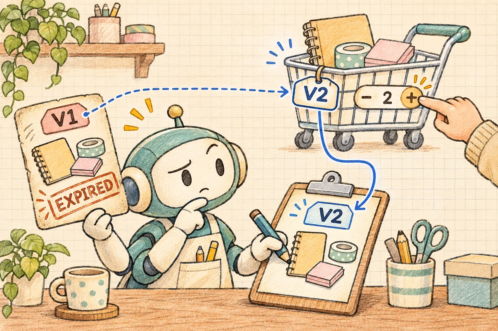

用户问：“还差多少钱包邮？帮我找个合适的凑单商品。”Agent 开始计算时，购物车里是一件商品；等建议出现，用户已经把数量改成了两件。

回答可能算得完全正确，却已经不适用于眼前的页面。这种问题不能只靠“记住聊天上下文”解决，因为购物车本身也在变化。

今天做一个 Vue 3 + TypeScript 购物车助手。它读取购物车快照，调用只读凑单工具，给出一个可核对的候选方案。用户修改购物车后，页面立即把旧建议标为过期，要求重新计算。



[打开在线示例](/examples/agent-cart-state-versioning/) · [下载完整源码 ZIP](/examples/agent-cart-state-versioning/source.zip)

## 1. 先确定建议依赖哪些状态

这个例子的业务规则刻意保持简单：固定的演示商品目录、固定包邮门槛、整数数量，不包含优惠券、会员价、税费、运费地区或促销叠加。所有商品、价格和库存都是虚构教学数据。

建议至少依赖商品 ID、数量、价格、库存和包邮规则。只把“帮我凑单”这句话交给模型，无法说明它基于哪一次购物车计算。

因此，发起任务时要保存一份独立快照，并为它附上购物车版本。工具使用快照，结果也绑定同一个版本。页面当前状态继续变化，不能反过来悄悄改写快照。

本例的版本是浏览器内单调递增的整数，生命周期限于当前页面。它用来解释状态关联，不是全局唯一订单版本，也没有实现多设备同步。

## 2. 用户编辑后，建议立即失效

页面左边是演示购物车，用户可以增加、减少数量或移除商品；右边显示建议状态和它对应的版本。点击生成后，模拟工具会等待一段时间，方便复现“计算期间编辑”的情况。

有两个时刻都要处理。计算还没结束时，购物车变化会使任务过期；建议已经显示后，购物车变化同样使它过期。不能只防迟到响应，却让已经出现的旧建议继续作为当前结论。

过期状态保留原因和版本信息，隐藏原来的有效建议，提供重新生成入口。页面不自动把候选商品加进购物车，也没有支付或下单接口。

为什么不只让用户停止生成？因为状态变化可能来自页面的其他入口，用户不必先去照顾聊天任务。助手应当追踪其依据是否仍然成立。

## 3. 请求编号与购物车版本各管一件事

请求编号回答“这是不是用户最后一次发起的任务”，购物车版本回答“这是不是当前业务状态”。两者不能互相代替。

```typescript
// 机制缩写；完整控制器和校验见 src/core.ts
const requestId = ++latestRequestId;
const snapshot = copyCart(currentCart);
const sourceVersion = currentCart.version;
const response = await queryTopup(snapshot);

if (requestId !== latestRequestId) return;
if (sourceVersion !== currentCart.version) return;
// 还需要校验 response，再发布为当前建议。
```

同一购物车可能连续生成两次建议：版本没变，较早请求也不能覆盖较晚请求。反过来，用户只生成过一次建议，但随后改了购物车：即使只按发起顺序看它仍是最后一次查询，业务依据却已经过期。

失败回调也要遵循同样规则。旧任务最后失败时，不能把新建议改成错误，或者把已经明确的过期状态改写成普通失败。新请求开始时清除旧结果，避免加载中还展示上一轮结论。

## 4. 数量改回去，也不是旧版本复活

假设数量经过 `1 → 2 → 1`。最终数量和最初一致，总金额也相同，但中间已经发生过两次编辑。只比较总价，会把旧请求误认为仍然有效。

本例每次接受真实的购物车变更，都在统一修改入口同步递增版本；数量改回去不会把版本减回去。没有改变内容的操作可以保持版本不变，但所有实际变化必须经过这个入口。

这一点尤其不适合只靠监听总价解决。Vue 会对某些更新进行批处理，总价也不能表达商品组合；不同商品甚至可以产生相同金额。页面显示总额可以使用纯计算，但业务变更的身份应该在修改动作里记录。

[Vue 的计算属性文档](https://vuejs.org/guide/essentials/computed.html)说明了响应式依赖与纯计算的关系。[侦听器文档](https://vuejs.org/guide/essentials/watchers.html)也讨论了旧异步响应的问题。清理或取消请求可以减少无用工作，本例则保留结果提交前的版本检查，故意让延迟任务返回以验证隔离是否有效。

## 5. 让凑单工具负责数字，模型只提出调用

示例采用固定模拟模型计划，调用一个只读凑单工具。它不理解任意用户对话，也不访问商品服务或真实模型 API。工具执行器限制调用名称、次数与快照参数，页面不接受任意动作。

默认购物车是笔记本 32 元 × 2，加签字笔 12 元 × 1，小计 76 元；演示门槛是 100 元，差额 24 元。短线 24 元一件、夹子 6 元一件，单 SKU 方案中都能恰好补足差额，并列时先选件数更少的短线。收纳袋虽在目录中，但模拟库存为零，不能参与推荐。

计算统一使用整数分，避免在业务运算中反复累加带小数的元。先计算当前小计和门槛差额，再遍历固定目录中的可用候选。

候选范围是“单一 SKU 的若干件”，不是任意多商品组合。每个候选要检查数量上限和演示库存；能覆盖差额的方案按新增金额排序，采用固定规则打破并列，得到可重复的结果。它只能称为这个有限候选集合内的最低新增金额方案。

这也不代表消费最划算。为了免运费多买商品，可能比直接支付运费花得更多；本例没有计算真实运费、需求价值或退货成本，因此只展示达门槛方案，不宣称它替用户省了钱。

工具结果需要运行时校验：版本是否属于本轮，商品是否存在，数量是否为允许范围内的整数，价格和小计是否能从可信演示目录重算。不能让模型提供一个未知商品 ID，再把它的名称和优惠文案直接画成卡片。

当购物车为空、已经达到门槛或没有可行方案时，各自显示明确状态，不为了“必须推荐点什么”而凑出商品。字段缺失、多余字段、伪造版本或计算被篡改，都应拒绝整个结果。

## 6. 源码下载后如何运行

源码包包含构建后的 `app.js`，解压后直接打开 `index.html` 即可运行。没有 API Key、CDN、登录或后端准备步骤。也可以在解压目录启动静态服务：

```bash
python3 -m http.server 8093 --bind 127.0.0.1
```

访问 `http://127.0.0.1:8093/`。这只是页面资源服务，不是模型或购物车业务 API。要修改 TypeScript，使用 Node.js 22 或更新版本：

```bash
npm ci
npm run typecheck
npm test
npm run build
```

首次安装需要下载锁定版本的依赖，已构建页面运行时不需要联网。`src/core.ts` 管理购物车版本、快照、建议计算和异步结果，`src/app.ts` 负责 Vue 交互，`test.ts` 保存可重复的离线场景。

页面状态不持久化，刷新后回到初始演示数据。测试的是本地确定性工具和模拟响应，不是模型推荐质量、生产库存一致性或真实购物转化。

## 7. 测试要覆盖建议出现前后

最容易遗漏的场景，是建议已经成功显示，随后用户再编辑。这个时候没有“迟到响应”可以拦，但建议仍然要失效。

| 场景 | 应观察到的结果 |
| --- | --- |
| 正常生成 | 结果绑定当前版本，金额可重算 |
| 生成期间修改数量 | 立即过期，旧结果返回后不恢复有效 |
| 已有建议后移除商品 | 旧卡片失效，提示重新生成 |
| 数量改成两件再改回一件 | 版本继续增长，原请求仍过期 |
| 同版本连续生成两次 | 只接受最后一次任务 |
| 旧任务晚到或失败 | 不覆盖当前任务状态 |
| 伪造 SKU、数量或金额 | 拒绝结果，不显示部分卡片 |
| 空购物车或已达门槛 | 显示对应状态，不补造候选 |

本次 25 个核心离线用例覆盖计算与状态边界，其中并发用例使用可控制完成顺序的 Promise，直接验证状态；浏览器再操作数量按钮和故障场景，核对用户真正看到的页面。电脑和手机都检查当前版本、过期提示、执行记录和重新生成入口，避免只让控制台断言正确。

这些验证覆盖示例约定的行为，不能说明所有并发问题都解决了。不同标签页、服务器更新、商品变价和真实模型调用还需要单独测试。

## 8. 真实购物车应把最终核验放在哪里

接入后端后，购物车版本应由可信服务维护。读到购物车和规则快照后，建议携带它们的版本；准备执行加入购物车等操作时，服务端重新检查身份、版本、价格、库存和业务条件，再决定是否允许写入。

HTTP 条件请求可以帮助表达这种前提。例如资源使用强 ETag 时，修改请求可携带 `If-Match`，由服务端在不匹配时拒绝；相关行为见 [MDN If-Match 说明](https://developer.mozilla.org/en-US/docs/Web/HTTP/Reference/Headers/If-Match)。这只是后续接入方向，本示例没有实现 HTTP 条件写入。

购物车之外，价格目录、活动规则和配送地区也可能独立变化。生产环境需要明确一个版本覆盖哪些依赖，或者为不同依赖携带独立版本。不能只检查购物车数量没动，就承诺建议仍然有效。

对话上下文保留的是用户说过什么；业务版本标记的是结论基于哪一次状态。让建议携带依据，并在依据变化时明确失效，页面才能告诉用户下一步该重新计算什么。
