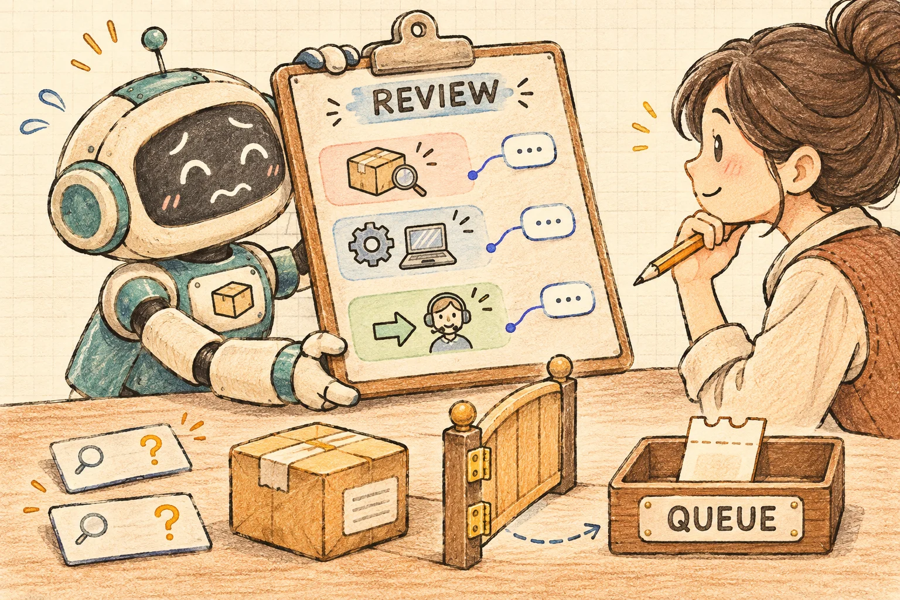

客服 Agent 连续两次查询物流失败，用户又把订单号说了一遍。页面如果继续弹出“请重试”，只是让人重复同一件事；如果直接显示“正在为你转人工”，却没有可接续的记录，下一位客服还得从头问起。

这次做一个 Vue 3 + TypeScript 转接示例：保留当前会话，生成可编辑的问题摘要，用户确认后保存到本页演示队列。失败计数负责提示何时需要帮助，摘要负责带走上下文，回执负责说明事情实际走到了哪一步。



[打开在线示例](/examples/agent-human-handoff-summary/) · [下载完整源码 ZIP](/examples/agent-human-handoff-summary/source.zip)

## 1. 转人工是业务流程，不是一句回复

一个可靠的转接入口至少要回答三个问题：为什么转接、交给下一位处理什么、目前是否真的有人接手。

本例用虚构订单 `DEMO-1001` 的物流查询贯穿流程。查询工具和模型响应都是固定模拟值，没有连接订单服务、客服平台或真实模型。用户点击按钮，才能推进对应步骤。

我们把界面里的事实分开：可以建议转人工，但尚未生成摘要；可以生成摘要，但尚未确认保存；可以保存进演示队列，但仍没有真人接入。本页只实现到最后一种本地状态。

[Microsoft 的转接协议说明](https://learn.microsoft.com/en-us/azure/bot-service/bot-service-design-pattern-handoff-human?view=azure-bot-service-4.0)区分了发起转接与后续状态通知，并允许转接携带会话记录。本文借用“发起不等于接管”的状态划分，不集成该 SDK 或任何客服平台。

## 2. 什么时候建议转接，什么时候直接允许

示例记录连续失败次数：一次查询明确失败，计数加一；查询成功，计数归零。连续两次失败时，页面提示可以转人工，但不会自动创建工单。

“两次”只是为了让演示可复现，不是通用客服策略。真实阈值要根据业务、工具错误类型和处理成本决定。缺少订单号也不一定属于工具失败，应先让用户补充，不能把所有异常都堆进同一个计数器。

另一个入口是用户主动要求转人工。它不需要先经历两次失败，也不应该被助手的“再试一次”挡住。示例始终保留这个按钮。

失败记录也不是处理结论。“查询未完成”不能变成“物流已丢失”；“用户希望人工核实”不能变成“已承诺赔付”。这里带走的是问题与尝试，结果仍然未知。

## 3. 摘要应当让人继续处理

摘要分成三类内容：当前问题、希望人工处理的目标、已经尝试过什么。前两项允许用户修改，尝试记录和消息来源保留为可核对事实。

初始问题来自实际演示会话中的用户消息，例如“我想查询演示订单 DEMO-1001 的物流进度。”查询失败会追加工具事件，摘要展示对应消息 ID 与原文，下一位处理者可以知道哪些步骤已经做过。

本例的固定模拟响应按原顺序返回当前会话的全部消息引用，不自由生成赔偿承诺、处理结果或新订单信息。程序校验消息 ID、原文和会话版本，再从可信记录构造摘要。这是可复现的抽取式草稿：问题取首条用户原文，期望使用固定提示，尝试记录保留原始会话，不做语义压缩。用户后续补写的文字标为人工编辑，不再假装它是模型已经核实的事实。

```typescript
// 边界示意；完整校验见 src/core.ts
const source = copyConversation(currentConversation);
const rawSelection: unknown = await selectMessages(source);
const checked = validateSelection(rawSelection, source);
const draft = buildEditableSummary(checked, source);
// 到这里仅形成草稿，不创建转接记录。
```

来源不存在、引用被改写、同一消息重复引用或字段结构不符时，整份摘要应拒绝。即便来源完全匹配，也只说明内容来自当前记录，不能证明用户说法或工具结果在现实中一定正确。

## 4. 会话更新后，旧摘要不能悄悄提交

摘要生成需要时间。用户可能在等待时追加消息，工具也可能刚好完成查询。此时旧摘要即使最后才返回，也不能覆盖新会话。

生成任务同时绑定请求序号与会话版本。较早请求不能覆盖较晚请求，旧会话摘要也不能被当成当前摘要。生成成功后，如果会话继续变化，原摘要要失效并要求重新生成。

这和购物车版本篇中的问题相似：对话文本本身也是会变化的业务依据。不能因为摘要看起来通顺，就忽略它究竟包含了哪些消息。

用户编辑草稿时，页面始终以当前编辑状态为准。示例使用显式 `value` 和输入事件同步 Vue 状态；这与[Vue 表单绑定文档](https://vuejs.org/guide/essentials/forms.html)描述的输入机制一致。摘要和原文按文字显示，不作为 HTML、模板或操作链接执行。

## 5. 确认的是编辑后的那一份

点击确认前，用户能够查看问题、目标、尝试记录和来源。保存时复制当前编辑稿，关联会话版本及本次操作标识；保存期间暂时锁定编辑和会话变更，防止回执对应的内容与用户看到的内容不一致。

操作标识在重试时复用。同一个确认快照重复到达内存队列，不应该创建两条记录；一旦用户修改草稿，则需要新的确认快照和操作标识。模型本身没有执行保存的入口。

确认按钮等待保存适配器的回执，并检查回执结构及其与当前快照的对应关系。不能看到一个任意的 `success: true` 就把页面改为完成。

如果队列实际写入后回执却被篡改，页面无法确认结果，应显示“结果待核对”，保留原操作标识和确认快照，并继续锁定编辑。核对重试只针对同一个操作；一次后续失败不能把未知结果改称“确定未保存”。示例提供错误回执故障来验证这个边界。

保存成功后的文案是“已进入本页演示队列，未接通真人”。队列行显示保存时的编辑内容，方便直接核对有没有丢掉用户修改。没有实际客服接管事件，就不出现“客服已接入”。

本例队列保存在当前页面内存，刷新即清除，不具备服务端可靠性或跨标签页去重。未来接入真实工单服务时，需要在服务端处理权限、持久化和幂等，不能把浏览器按钮防抖当成最终保障。

## 6. 保存失败，用户的修改要留下来

故障模式模拟“写入前明确失败”：队列不新增记录，页面保留已经编辑的摘要，解除锁定，允许重试。错误文案说明尚未保存，不能同时展示一个容易被误认成转接成功的绿色提示。

这个演示没有模拟“服务端写成功但响应丢失”。真实接口遇到超时，结果可能未知，应按操作标识查询确认，不能因为没收到响应就断言没有保存。相关机制可以沿用本系列的幂等与未知结果篇。

另一个恢复入口是复制摘要。只有 `navigator.clipboard.writeText()` 的 Promise 成功后，才显示已复制；权限不足或浏览器不支持时，保留可选中的完整文本，供用户手动复制。[MDN 的说明](https://developer.mozilla.org/en-US/docs/Web/API/Clipboard/writeText)列出了安全上下文与权限限制。

复制只是把文字交给用户，不会保存工单，也不会对外发送消息。我们不读取用户剪贴板，不自动打开客服软件，也不把复制成功当成转接成功。

## 7. 运行示例并验证关键路径

下载源码后，直接打开 `index.html` 即可运行构建好的 Vue 页面，无需密钥或外部 CDN。也可以在解压目录启动静态服务：

```bash
python3 -m http.server 8094 --bind 127.0.0.1
```

访问 `http://127.0.0.1:8094/`。要修改 TypeScript，使用 Node.js 22 或更新版本，执行：

```bash
npm ci
npm run typecheck
npm test
npm run build
```

首次安装需要下载锁定依赖，已构建页面运行时不调用模型或业务接口。`src/core.ts` 负责会话、摘要校验与转接控制，`src/app.ts` 负责 Vue 页面和复制降级，`test.ts` 保存离线断言。

| 场景 | 应观察到的结果 |
| --- | --- |
| 连续两次查询失败 | 建议转人工，尚未自动入队 |
| 失败后查询成功 | 连续失败数归零 |
| 用户直接要求人工 | 无须等待失败阈值即可准备摘要 |
| 伪造消息 ID 或原文 | 拒绝摘要，不提供可确认结果 |
| 生成期间会话变化 | 旧摘要不覆盖新状态 |
| 编辑后确认保存 | 队列内容与确认快照完全一致 |
| 保存前明确失败 | 保留编辑稿，队列不新增 |
| 重复确认同一快照 | 不生成重复记录 |
| 复制权限被拒绝 | 提供手动复制文本，不声称已保存 |

本次 32 个核心离线测试与浏览器检查通过。测试结论限制在固定模拟响应、内存队列和这些状态约束。它没有测量真实模型摘要质量，没有真实工单受理，也没有真人端会话验证。

## 8. 接入真实客服平台还差哪些步骤

真实转接服务应当根据当前账号和会话权限建立请求，而不是相信模型传来的用户身份。提交时只携带人工处理所需的上下文，明确区分用户陈述、工具结果和人工编辑内容，避免把全部历史和敏感数据不加选择地发送出去。

服务返回排队标识后，页面可以显示已受理或排队。之后再由可信状态通知区分真人接入、处理结束和转接失败；断线重连需要查询当前状态，不能靠本地计时器宣布“客服已接通”。

如果用户改变问题或取消排队，还需要与平台约定更新、取消和恢复方式。摘要版本、会话 ID、操作标识与受理记录应能关联起来，才能查清某次转接带走了哪一份内容。

Agent 无法继续时，好的出口是把问题、已做尝试和下一步意图交代清楚，让用户保有修改和确认的机会。页面显示的状态，则应当始终对应已经获得的证据。
