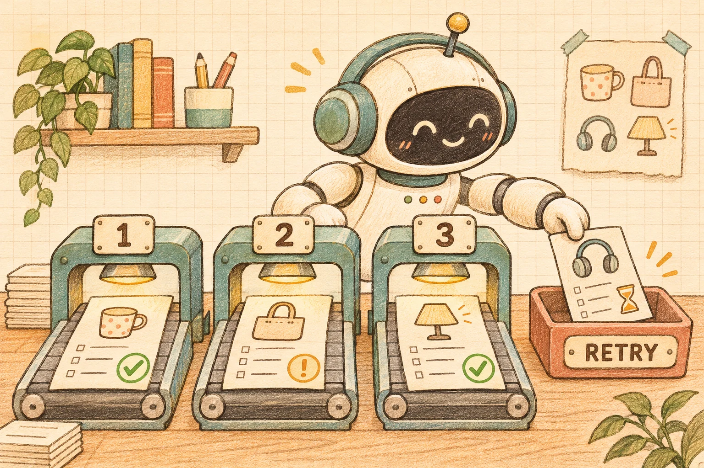

运营把十件待上架商品交给 Agent：“帮我检查标题、图片说明和必填参数。”如果页面只出现一个转圈图标，等最后再弹出“检查失败”，运营不知道前九件有没有结果，也不知道重试会不会把已经完成的工作全部再做一遍。

这次用 Vue 3 + TypeScript 做一个批量检查入口：逐件显示结果，最多三个任务同时执行，一件超时不挡住其他商品，重试只处理符合条件的失败项。页面始终保留每件商品的状态和调用次数，便于核对“这一次到底检查了什么”。



[打开在线示例](/examples/agent-batch-product-audit/) · [下载完整源码 ZIP](/examples/agent-batch-product-audit/source.zip)

## 1. 先划清 Agent 和程序各自负责什么

Agent 可以把用户的要求整理成工具调用计划。计划进入执行器后，工具白名单、商品范围、并发数和重试预算由程序控制，不能因为模型说“再检查一百次”就无限执行。

本例没有调用真实模型。页面使用固定的模拟计划，工具读取十件虚构商品，在浏览器内检查三个字段是否为空：标题、图片文字说明、规格参数。图片说明只是演示字段，不下载图片、不做视觉理解，也不检查真实图片是否存在。

因此，这是一份 Agent 工具执行层的最小示例：模拟计划 → 校验 → 有限队列 → 逐项结果。它不是商品质量模型，也不能证明某份上架资料已经符合实际业务标准。发现空字段之外的事实错误、描述是否准确、规格是否匹配商品，都超出了本例的检查能力。

如果业务只需要固定字段检查，直接运行规则即可；引入模型的价值应来自理解不同检查目标或解释结果，而不能靠给普通循环换个名称来证明。

## 2. 一件商品需要独立的状态

把整个批次简化成 loading、success、error，会丢失最有用的信息。这里每行都记录商品 ID、当前状态、已尝试次数和发现的问题。

| 状态含义 | 页面如何呈现 | 是否重试 |
| --- | --- | --- |
| 排队或执行中 | 还没有最终检查结果 | 不重复启动 |
| 检查完成且无缺项 | 当前规则未发现缺失 | 不重试 |
| 检查完成但有缺项 | 显示需要补充的字段 | 不靠重试修复资料 |
| 暂时执行失败或超时 | 说明本次没拿到有效结果 | 有预算才允许 |
| 返回结构或归属错误 | 拒绝采用该结果 | 不自动重试 |

“资料缺少标题”是有效的业务检查结果，不是网络错误。重复调用同一工具，不会自动把标题补上。反过来，工具超时也不能写成“商品没有问题”，因为这时根本没有完成检查。

界面的进度表示当前批次已经结束的商品占比，失败也计入已处理。它不是商品通过率。重试时，两条失败行重新变成处理中，默认进度会从 10/10 回到 8/10，再回到 10/10；此前已经完成的八行保持原样。

## 3. 三个执行位置，比十个 Promise 更重要

一个常见写法是先对十件商品执行 `map(checkProduct)`，再用 `Promise.allSettled()` 收集结果。这样便于保留每项成功或失败，却通常已经在 `map` 期间启动了全部任务。

[MDN 的 Promise.allSettled 文档](https://developer.mozilla.org/en-US/docs/Web/JavaScript/Reference/Global_Objects/Promise/allSettled)说明它会等待所有输入任务结束，并返回各项结果。由这个行为可以判断：它负责汇总，不负责规定何时启动第几个工具。

我们的执行器维护待处理队列和三个执行位置。某个位置真正空出来后，才能取下一件。下面是调度思路，完整的状态、异常和版本校验在源码中：

```typescript
// 调度示意：每个 worker 一次只等待一个工具。
let nextIndex = 0;
async function worker(): Promise<void> {
  for (let step = 0; step < jobs.length; step += 1) {
    const index = nextIndex++;
    if (index >= jobs.length) return;
    await runOne(jobs[index]); // 单项失败在 runOne 内转成行状态
  }
}
await Promise.all(Array.from({ length: 3 }, () => worker()));
```

本例实际执行器还会限制批次大小和每件商品的调用预算，避免重复点击叠加任务。单项异常被记录到对应行，队列继续取下一件，不把剩余商品悄悄删除。

这里的并发是异步任务同时在途，不等于浏览器启动三个 CPU 线程。页面显示当前在途数、峰值和累计工具调用数，便于观察队列是否遵守约定。

## 4. 超时之后，执行位置真的空了吗

只把工具调用和超时 Promise 放进 `Promise.race()`，会出现一个容易忽略的问题：超时 Promise 先结束了，原工具却可能还在运行。如果立即补进一个新任务，实际工作数量可能继续增长。

本例为每次尝试创建 AbortController。超时后发出中止信号，模拟工具监听信号、清除定时器并结束自己的 Promise；执行器等它真正结束后才释放位置。正常完成也会清理计时器和监听器。

[MDN 的可中止 API 示例](https://developer.mozilla.org/en-US/docs/Web/API/AbortSignal#implementing_an_abortable_api)展示了这种合作方式：发出 signal 只是通知，接收它的 API 需要实现退出与清理。

这保证的是当前模拟工具的行为。真实服务可能已经收到请求并开始处理，浏览器中止等待不能证明服务端任务已停止。接入真实服务时，应在服务端约束并发、查询任务状态，并定义取消协议。若适配器不响应中止，本例也不会假装位置已空闲；它可能保持等待，需要修复适配器或改用有服务端任务管理的方案。

## 5. 重试要有范围，也要有终点

默认故障场景里，P03 第一次暂时失败，P07 第一次超时，其余商品照常完成。用户点击重试后，只再次检查这两件；已通过的行和已有缺项结论不会被清空。

每件商品最多尝试两次，单批次最多二十次工具调用。默认演示因此是首轮十次、重试两次，共十二次。上限针对同一个批次，重置后开始新批次会重新计数；它不是跨页面、跨用户的全局配额。

```typescript
// 筛选条件示意，实际错误分类由执行器确定。
const retryIds = rows
  .filter(row => row.status === 'retryable' && row.attempts < 2)
  .map(row => row.id);
```

预算不能只写在按钮禁用条件里。即使调用者绕过界面连续调用重试，控制器也应检查当前是否仍在执行、哪些行符合条件，以及预算是否耗尽。第二次仍失败，就展示需要进一步检查的状态，不继续自动循环。

生产系统还应处理退避、限流和错误分类。例如权限错误不会因为立刻重试就变得合法。这里没有随机退避和真实 HTTP 状态码，保留固定故障是为了让读者能稳定复现同一条路径。

## 6. 返回结果必须属于当前这件商品

工具返回的是运行时数据，TypeScript 类型不能代替校验。结果至少要与批次、资料版本、商品 ID 和尝试编号对应，本例还会按本地固定规则重新计算缺项，并要求回执与计算结果一致。不能把 P03 的结果放到 P04 行，也不能接受旧批次迟到的结论。

模型计划同样需要校验：只允许 `check_product`，只接受当前十件商品的已知 ID，不允许重复 ID、越界数量或额外写入工具。无效计划在工具启动之前拒绝，调用次数仍为零。

重置运行中的批次时，先使旧结果失效，再通知已经启动的工具结束。退出期间不允许新批次叠加；待旧调用收尾后，页面回到可开始状态。请求序号的作用是拒绝旧结果，和释放执行位置是两件不同的事。

Vue 页面接收控制器生成的新状态快照，用 `shallowRef` 替换整个 `.value` 来刷新列表。[Vue 官方文档](https://vuejs.org/api/reactivity-advanced.html#shallowref)解释了它只追踪这一层替换；如果只改内部字段却没有替换快照，不能指望同样的更新行为。商品和错误内容按文本渲染，不作为 HTML 或工具指令执行。

## 7. 运行并观察成功与失败路径

下载源码 ZIP 后，直接打开 `index.html`，即可使用已构建的 Vue 页面，无需模型密钥、登录或 CDN。也可以在解压目录启动静态服务：

```bash
python3 -m http.server 8095 --bind 127.0.0.1
```

访问 `http://127.0.0.1:8095/`。修改源码需要 Node.js 22 或更新版本；首次安装依赖需要网络：

```bash
npm ci
npm run typecheck
npm test
npm run build
```

`src/core.ts` 管计划校验、队列和行状态，`src/app.ts` 管 Vue 交互，`test.ts` 保留离线回归用例。检查的不只是最终文案，还包括真实进入工具函数的次数、峰值和每行尝试历史。

| 操作 | 核对重点 |
| --- | --- |
| 启动默认批次 | 峰值不超过 3，十件商品均有行状态 |
| 等待 P03 失败和 P07 超时 | 其他商品继续完成，失败行不能显示通过 |
| 只重试失败项 | 总调用从 10 增至 12，其他八行不重跑 |
| 持续失败直到预算耗尽 | 每件最多两次，不能无限点重试 |
| 使用无效计划或伪造结果 | 分别在调用前或展示前拒绝 |
| 运行中重置后重新开始 | 旧结果不污染新批次 |

本次类型检查、构建和 37 项核心离线测试通过；电脑和手机浏览器已验证部分失败、只重试失败项、预算耗尽、无效计划、伪造回执和重置后的新批次。这里没有真实模型判断、远端商品服务或线上吞吐量测量；离线通过不能推导出生产环境稳定性。

## 8. 从演示走向运营后台

接入真实商品系统时，后端应根据当前账号确定可检查的商品范围，并给资料快照关联版本。运营修改了商品，再展示旧版本检查结果，需要明确标记过期，而不是继续保留一个无条件的绿色通过标签。

如果以后加入“补全资料”工具，应把检查与修改分开。检查结果先形成草稿，让用户看见变更和依据，再由有权限的服务执行保存。重试一次检查不会修改商品，但重试一次写入可能重复产生业务效果，两者不能共用未经区分的恢复策略。

这个最小示例的目标是让批量工作变得可观察、可解释、可恢复：运营能看见哪些已经检查、哪些还缺资料、哪些只是执行失败，以及下一次重试会处理谁。
