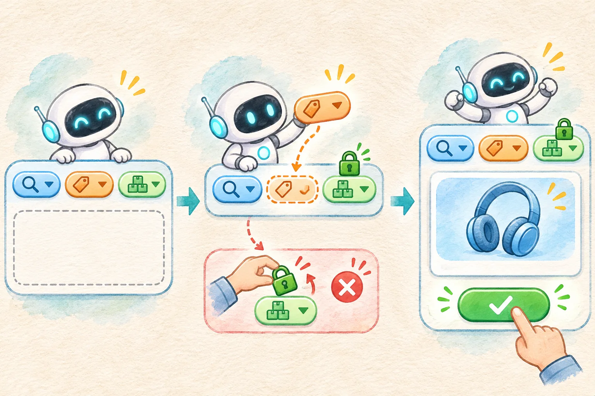

## 搜不到商品，不代表可以替用户改主意

用户在商城里搜索“蓝色耳机、300 元以内、必须有货”。结果为 0 件。一个看似积极的 Agent 可能直接去掉“蓝色”，再把缺货商品塞进结果，最后说“帮你找到了”。页面确实出现了卡片，用户的要求却被悄悄改写了。

更可靠的交互是把零结果拆成两步：先确认只读查询确实返回空列表，再让 Agent **提出一项可选条件的调整建议**。页面展示原条件与新条件，用户明确确认后才重新查询。分类、账号权限、是否有货等业务硬条件由应用锁定，模型的建议不能修改。本文用 Vue 3 + TypeScript 实现这个最小流程；数据和“模型响应”全部固定在本地。

示例起始筛选是“耳机 / 蓝色 / 300 元以内 / 必须有货”。演示目录有一副 399 元的蓝色耳机、一副 269 元的黑色耳机，还有一副 259 元但缺货的蓝色耳机。严格查询为 0 件。安全建议把价格上限改到 400 元，用户确认后才出现第一件；企图取消“必须有货”的建议会被拒绝。



## 先给每个条件划清权限

这不是让模型“自由探索更多结果”。筛选条件有不同来源，应用需要先写清楚哪些可以讨论、哪些不能碰：

| 条件 | 示例值 | 处理方式 |
| --- | --- | --- |
| 商品分类 | 耳机 | 锁定；示例只查询耳机目录 |
| 必须有货 | 是 | 锁定；缺货商品不能作为符合条件的结果 |
| 颜色 | 蓝色 | 可建议改为不限，但一次只改一项 |
| 价格上限 | 300 元 | 可建议提高，演示上限为 500 元 |

这些只是本例的产品规则。真实商城里，价格上限可能是用户绝不愿放宽的硬条件，运费、品牌或配送时效也可能属于硬条件。不能从“模型觉得可放宽”推断用户愿意放宽。可调整范围应由页面和服务端协议定义，再让模型在范围内提出候选。

只读查询工具接收当前筛选，返回 `found`、`empty` 或 `timeout`。空列表和超时必须分开：超时表示**不知道有没有结果**，不能触发“放宽后再搜”的流程。示例中的 `searchProducts` 只过滤一个虚构数组，没有网络请求；`toolCalls` 只统计页面对这个本地函数的调用次数。它不是生产搜索服务，也没有真实库存。

## 模型建议只是一份候选数据

在真实工具调用流程中，模型可以给出工具名和参数，但应用负责执行工具，并处理其结果。[OpenAI 的 Function Calling 文档](https://developers.openai.com/api/docs/guides/function-calling)把“接收调用、由应用执行、返回结果”分成明确步骤。本例没有调用该 API，只把这条职责边界缩成一个固定的 `mockModelProposal`：它返回看似由模型生成的对象；应用先校验，绝不直接执行。

建议对象包含原筛选版本、单项变更和理由。关键校验如下，完整实现见下载源码的 `src/core.ts`：

```ts
const keys = Object.keys(raw.changes)
if (keys.length !== 1) {
  return { ok: false, error: '每次只能调整一项可选条件。' }
}
const key = keys[0]
const value = raw.changes.maxPrice
const reason = raw.reason.trim()
if (key === 'maxPrice' && typeof value === 'number'
    && Number.isInteger(value) && value > current.maxPrice && value <= 500) {
  return { ok: true, value: {
    next: { ...current, maxPrice: value }, changed: 'maxPrice', reason
  } }
}
return { ok: false, error: '建议试图修改锁定条件或使用未知字段，已拒绝。' }
```

实际代码还核对顶层字段集合、理由长度、查询是否确认为零结果、建议版本是否匹配当前筛选。`inStock: false`、同时修改颜色和价格、把上限提高到 900 元，都会失败。页面不会从失败对象里提取部分字段继续运行，避免“忽略非法字段后照样执行”造成含糊行为。

这里的 `versionOf` 是根据固定筛选字段拼出的演示版本串，作用是发现页面状态变化后的过期建议。它不是安全凭证。真实系统如果涉及用户身份、库存或价格，应在服务端依据当前会话和最新数据重新校验，不能信任前端版本串，更不能把模型返回的 `inStock` 当成授权。

## Vue 页面把“建议”和“执行”分开

页面上有三步：查询演示商品、生成并校验建议、确认调整并重新查询。第二步只展示差异，不更改 `filters`，也不再次调用搜索。第三步才把校验过的 `next` 条件作为当前筛选，并执行只读查询。核心状态分别是 `filters`、`lastSearch` 和 `check`，没有把一段模型文案当成页面状态。

```ts
const suggest = () => {
  if (!lastSearch.value) return
  check.value = validateProposal(
    mockModelProposal(candidate.value, filters.value),
    filters.value,
    lastSearch.value
  )
}
const confirm = () => {
  if (!check.value?.ok || !lastSearch.value) return
  if (lastSearch.value.version !== versionOf(filters.value)) return
  filters.value = check.value.value.next
  runSearch()
}
```

[Vue 官方 TypeScript Composition API 指南](https://vuejs.org/guide/typescript/composition-api)说明了 `ref()` 的类型推断；示例据此保存当前筛选和结果。模板用文本插值渲染建议理由，不把建议作为 HTML 插入页面。对页面用户来说，重要的是能看到“价格 ≤ 300 → 价格 ≤ 400”，并且“必须有货”仍带锁定标记。页面布局在手机宽度下改成单列，差异和确认按钮仍在同一建议区域。

这个设计还有一个容易漏掉的时序问题：假设 Agent 生成建议期间用户改了筛选，旧建议不能继续套用。示例比较 `baseVersion`、最后一次查询的版本和当前筛选版本；不一致就拒绝，要求重新查询。示例没有真正的并发模型请求，但这条校验同样适用于异步返回晚到的场景。

## 把失败路径也放进可运行示例

[打开在线示例](/examples/agent-filter-relaxation/)或[下载完整源码 ZIP](/examples/agent-filter-relaxation/source.zip)。解压后可直接打开 `index.html`；构建产物已打包 Vue，不依赖 CDN 或密钥。也可以在解压目录运行：

```bash
python3 -m http.server 8097 --bind 127.0.0.1
```

随后打开 `http://127.0.0.1:8097/`。想修改 TypeScript 源码，可用 Node.js 22 或更高版本运行：

```bash
npm ci
npm run typecheck
npm test
npm run build
```

首次 `npm ci` 需要访问 npm 注册表；已构建的网页运行不需要网络。页面中可按下面四条路径验收：

1. 初始查询显示 0 件；选“可接受”候选，生成建议后旧筛选不变；点击确认后才显示演示蓝色耳机 A。
2. 重置后选“危险”候选。它试图把 `inStock` 改为 `false`，校验拒绝，页面仍标注“必须有货”，查询次数不增加。
3. 重置后选“过期”候选。它带旧版筛选标识，页面拒绝应用。
4. 勾选“模拟只读查询超时”再查询。页面显示结果未知，不能把超时当成零结果生成建议。

此外，离线断言检查了两项同时修改、价格超过演示上限、旧查询结果被套到新筛选等情况。**这些验证只覆盖固定样本和本地函数**。页面没有真实模型调用、真实商品服务、付款、订单写入或外部消息；测试通过也不意味着生产 Agent 的建议质量已被评估。

## 接真实 Agent 时要保留哪些边界

可以把模型输出限制为结构化候选，让它只提供 `baseVersion`、一项 `changes` 和 `reason`。但“结构化”解决的是格式约束，不能替代业务授权。[OpenAI 的 Structured Outputs 文档](https://developers.openai.com/api/docs/guides/structured-outputs)说明了结构化输出与工具调用各自的用途；应用仍要在执行前检查字段、权限和当前状态。

真实查询还需要记录筛选来源、库存数据时间、工具超时与失败原因。如果推荐结果依赖第三方库存，页面要说明其时效性；如果用户确认后库存变了，服务端应以新查询结果为准，而不是复用建议生成时的旧卡片。多标签页和连续点击也要纳入真实接入设计：一次确认应只指向生成它的那份建议，而不是“当前页面最后一份建议”。服务端可以给建议分配短期 ID，保存原筛选快照和过期时间；确认时核对登录会话、建议版本和当前筛选，再执行新的只读查询。过期或版本不一致时让用户重新查看条件。本文没有服务端，因此只演示前端的版本比对，不能把它当成跨设备或跨会话的并发控制。

对于付款、下单等写操作，建议与确认只是前置交互，还需要服务端权限、幂等和结果核对。本文故意停在**只读搜索**：先让“改了什么、谁确认的、依据哪次查询”变得可见，再决定是否扩展到更复杂的业务操作。
