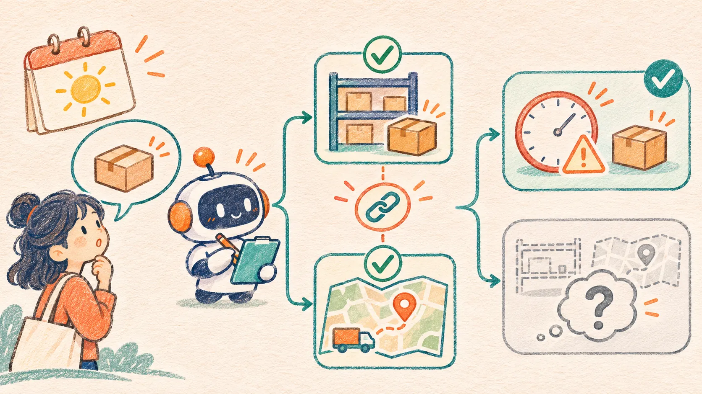

## 用户问“明天能到吗”，Agent 不能靠语气回答

商品详情页里，用户问：“这件商品明天能送到我这里吗？”这句话看起来适合让 Agent 直接回答，实际需要同时核对库存、配送覆盖区域、最早配送日期和截单时间。只要一项数据没拿到，“大概率可以”就可能变成页面上无法兑现的承诺。

本文做一个 Vue 3 + TypeScript 的最小演示：页面先调用两项**只读**工具，再检查模拟 Agent 给出的回答是否与工具记录一致。结果分成三类：演示规则支持显示“次日预计送达”、已核实的条件不支持次日送达、目前无法确认。第三类不是失败文案的装饰；库存查询超时、配送查询超时、数据过期都必须落到这里。

演示商品 `SKU-01`、区域 A/B、库存数量、配送范围和时间全部是虚构固定数据。演示时钟固定在 **2026-11-08 10:00，北京时间**，“次日”固定指 2026-11-09。没有真实模型请求，也不查询物流公司、真实仓库或用户地址；页面不会下单或发送消息。读者可以根据工具卡片逐项核对每个结论。



## 把一句自然语言拆成两次只读核对

这个问题至少包含两个业务事实。库存工具回答“这件商品现在有多少可售件”；配送工具回答“所选区域是否覆盖、最早配送日期是什么、何时截单”。成功响应各自返回 `sourceId` 和 `checkedAt`；超时响应只保留查询 ID 与超时状态。页面保留工具记录，而不是只保留 Agent 最后一句话。

| 工具 | 演示字段 | 页面要检查 |
| --- | --- | --- |
| `readInventory` | `quantity`、`checkedAt`、`sourceId` | 是否成功、库存是否大于 0、数据是否过期 |
| `readDelivery` | `covered`、`earliestDate`、`cutoffAt`、`checkedAt`、`sourceId` | 是否成功、区域是否覆盖、日期和截单时间是否满足 |

[OpenAI 的 Function Calling 文档](https://developers.openai.com/api/docs/guides/function-calling)把模型提出工具调用、应用执行工具、把结果交回模型列为不同步骤。本例只模拟“应用执行与核验”这段：`readDemoTools()` 根据选中的演示场景产生两份固定工具结果，`mockAgentAnswer()` 产生一个固定候选回答。**工具数据不能从模型文案里倒推**；真实接入时，库存和配送服务应分别由可信后端调用，模型只负责提出问题或组织可审查的回答。

工具结果需要三种语义。库存为 0 或区域明确不覆盖，可以说当前条件不支持次日送达；任何一项查询超时，则连条件是否满足都不知道。过期时间戳同样无法支持新承诺。示例为便于复现设置五分钟演示有效期，真实系统应由库存、履约和产品团队定义时效策略，并考虑锁库存、不同仓库和并发变化。

## 让页面独立计算回答边界

即使 Agent 输出了 `verdict: "tomorrow"`，页面也不会直接展示。`decide()` 从两份工具结果计算允许的状态：先处理超时与过期，再处理缺货和不覆盖，最后检查最早日期及截单时间。这一顺序偏保守：只要缺少一份必要证据，就显示“无法确认”，不会把另一个工具的成功当作完整证明。

```ts
export function decide(snapshot: ToolSnapshot, now = DEMO_NOW): Decision {
  const { inventory, delivery } = snapshot
  if (inventory.status === 'timeout' || delivery.status === 'timeout') {
    return { verdict: 'unknown', reason: '至少一项只读查询超时，无法核实配送条件。' }
  }
  if (!fresh(inventory.checkedAt, now) || !fresh(delivery.checkedAt, now)) {
    return { verdict: 'unknown', reason: '库存或配送数据已过期，需要重新查询。' }
  }
  if (inventory.quantity <= 0) return { verdict: 'unavailable', reason: '演示库存为 0，不能给出次日送达结论。' }
  if (!delivery.covered) return { verdict: 'unavailable', reason: '演示配送范围未覆盖所选区域。' }
  if (Date.parse(now) >= Date.parse(delivery.cutoffAt) ||
      delivery.earliestDate !== '2026-11-09') {
    return { verdict: 'unknown', reason: '演示截单时间已过，或最早日期不是次日。' }
  }
  return { verdict: 'tomorrow', reason: '演示库存、配送范围、最早日期和截单时间均满足固定规则。' }
}
```

完整函数在源码 `src/core.ts`。代码中的 `DEMO_NOW` 是固定时刻，不代表当前真实时间。`fresh()` 用完整的 ISO 时间串比较毫秒差，并拒绝“来自未来”的时间戳；它只演示时效检查，不是生产级库存一致性保证。[MDN 的 `Intl.DateTimeFormat` 文档](https://developer.mozilla.org/en-US/docs/Web/JavaScript/Reference/Global_Objects/Intl/DateTimeFormat)展示了显式设置 `timeZone` 的方式。真实页面应把存储时间、用户展示时区和履约规则时区分开，避免浏览器本地时区改变截单判断。

## 模拟回答带证据，但证据也要核验

候选回答包含当前查询 `key`、结论 `verdict`、理由和两个 `sourceId`。页面先确认查询条件没变，再核对字段集合、版本、证据 ID 和结论。假如用户刚把区域 A 切到 B，旧区域的配送记录即使显示“覆盖”，也不能用于 B。假如模拟 Agent 写出“明天保证送到”并附上不存在的 `stock:invented`，页面拒绝这段候选，保留本地规则给出的状态。

```ts
if (snapshot.key !== selectionKey(current)) {
  return reject('区域或场景已变化，旧查询结果不能用于当前回答。')
}
if (!Array.isArray(raw.evidence) || raw.evidence.length !== 2 ||
    raw.evidence[0] !== snapshot.inventory.sourceId ||
    raw.evidence[1] !== snapshot.delivery.sourceId) {
  return reject('回答引用的工具结果与本次查询不一致。')
}
if (raw.verdict !== fallback.verdict) {
  return reject('回答与已核实的库存或配送结果冲突。')
}
```

这几个字符串 ID 是演示关联键，不能防止客户端伪造。真实系统要在服务端把工具响应绑定到请求、账号、商品、收货区域和时间，防止前端篡改。模型生成的理由也只能作为候选说明，不能成为配送保证的依据。页面用 Vue 文本插值渲染理由，不把模型内容当 HTML 注入。

## Vue 页面把“查询”与“回答”分开

界面上先选择区域和工具结果场景，再按“查询库存和配送”；两张工具卡片分别显示状态与更新时间。第二个按钮“验证模拟回答”才产生候选并运行 `validateAnswer()`。页面用 `ref<ToolSnapshot | null>` 保存已查询快照、用 `ref<AnswerCheck | null>` 保存校验结果；[Vue 官方 TypeScript Composition API 指南](https://vuejs.org/guide/typescript/composition-api)给出了 `ref()` 指定复杂类型的写法。

```ts
const snapshot = ref<ToolSnapshot | null>(null)
const check = ref<AnswerCheck | null>(null)
const query = () => {
  snapshot.value = readDemoTools(current())
  check.value = null
}
const answer = () => {
  if (!snapshot.value) return
  check.value = validateAnswer(
    mockAgentAnswer(snapshot.value, mode.value), snapshot.value, current()
  )
}
```

页面同时显示应用自己计算的规则结论。这样即使候选回答被拒绝，用户也能看到“缺少哪份证据”，而不是收到一个没有解释的通用报错。手机宽度下两张结果卡变为单列，按钮仍按查询、验证的顺序排列。演示的两个工具只是本地同步函数；接真实接口时还要处理请求取消、晚到响应、网络重试和服务端重新核价或核库存，不能把这个演示的版本串当作安全机制。

## 运行并检查成功与失败路径

[打开在线示例](/examples/agent-delivery-promise-evidence/)或[下载完整源码 ZIP](/examples/agent-delivery-promise-evidence/source.zip)。源码包包含构建后的 `app.js`，解压后在目录里运行：

```bash
python3 -m http.server 8098 --bind 127.0.0.1
```

打开 `http://127.0.0.1:8098/`。若要修改 TypeScript，需要 Node.js 22 或更高版本；首次安装依赖需要访问 npm 注册表：

```bash
npm ci
npm run typecheck
npm test
npm run build
```

按下面顺序观察页面：

1. 默认“库存与配送都可用”先查询再验证，页面显示固定演示规则允许“次日预计送达”。这只对应演示日期，不是实际服务承诺。
2. 分别选择“库存为零”和“配送未覆盖”，验证后显示当前条件不支持次日送达。
3. 分别选择库存查询超时、配送查询超时和数据已过期，验证后均显示“尚不能确认时效”；超时不等于缺货，也不等于可送。
4. 选择“虚构证据并承诺”，候选中的证据 ID 与本次工具记录不匹配，页面拒绝它。查询后再切换区域，旧结果也被拒绝。

离线断言还检查了错误结论、未知字段、缺失结构、截单时间已过和未来时间戳。它们只验证固定样本与本地纯函数；**没有真实模型质量评测，也没有真实配送 SLA 验证**。接入生产时还需查真实服务的可用性、更新时间、配送规则版本，并由履约系统决定可展示的承诺用语。

## 真正接入时，谁能说“明天送达”

页面可让 Agent 用自然语言解释已核实的条件，但最终状态和承诺词应由履约服务的规则输出。库存与配送覆盖在查询后仍会变化，所以“可显示次日预计送达”也应被视为带时间和适用条件的估计；下单确认阶段必须重新核验。若区域信息来自用户地址，还要按账号权限最小化读取和传递，不把详细地址写进提示词或日志。

本例的边界很窄：一个商品、两个只读工具、固定演示时间、固定模拟回答。它说明的是前端怎样让证据可见、让不确定性有自己的状态，并在 Agent 说得过满时收住页面文案。这个结构可以扩展到门店自提、售后处理时效、服务预约等场景，但每个场景都需要自己的权威数据源和承诺规则。
