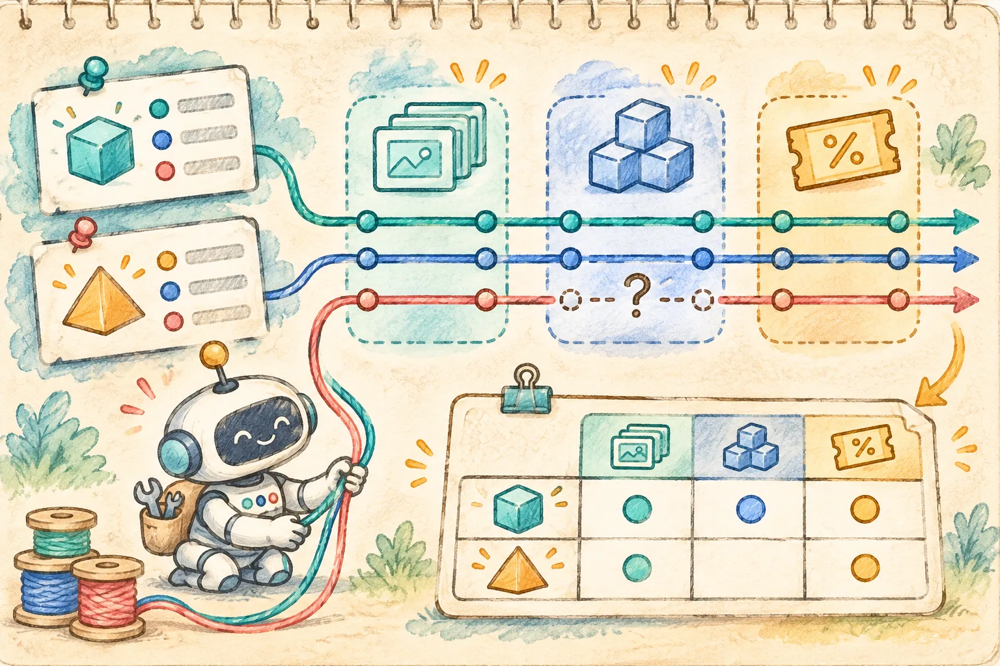

## 比价问题为什么需要三种工具

用户在商品详情页勾选两款耳机，问 Agent：“哪款更适合我？”页面很容易把这件事简化成让模型总结商品文案。实际比较至少涉及三种会变化的事实：商品资料、当前库存和可用优惠。资料说 A 续航更长，不代表它现在有货；标价低，也不代表优惠后价格更低。把三份结果混成一段流畅文案，读者很难看出哪句有依据、哪句只是猜测。

这篇用 Vue 3 + TypeScript 做一个可运行的最小实验：选定两件**虚构商品**，并行读取三个本地只读工具，按字段保留来源，再核对固定的模拟 Agent 回答。默认样本中，A 标价 399 元、续航 32 小时、重 220 克，优惠后 359 元；B 标价 429 元、续航 25 小时、重 185 克，优惠后 329 元。页面可以说“B 在这份演示数据里优惠后更低，A 续航更长”，但不替用户决定“最适合”。

所有商品、库存、折扣与时间均为演示数据。演示时钟固定在 **2026-11-10 20:00（北京时间）**。示例没有真实模型调用、商品接口、付款或下单操作；`mockCandidate()` 返回预置对象。后端的账号权限、优惠适用性和最终结算价格也不在这个静态演示里得到验证。



## 用户交互：先收集，再解释

页面把交互拆成两步。第一步点“查询三个只读工具”，分别显示 `catalog`、`stock`、`offer` 的结果或错误，生成本轮快照。第二步点“验证模拟回答”，只有三项工具都成功、来源仍属于本轮且没有过期，才接受候选句子。查询后若切换商品选择版本，旧快照仍可看，但比较状态变为“证据已过期”，需要重新查询。

工具返回的不是一串可直接显示的文字，而是有结构的数据：`selectionKey` 绑定商品选择版本；`sourceId` 标明本轮工具来源；`checkedAt` 记录查询时刻；金额以整数分保存。三分钟的新鲜度只用于这个固定样本，不是建议照搬的业务规则。真正的商品系统需要后端按商品、地区、用户资格和活动规则定义有效期。

| 工具 | 本例提供的字段 | 失败后还能说什么 |
| --- | --- | --- |
| `catalog` | 名称、续航、重量、标价 | 没有资料就不生成比较表 |
| `stock` | 两件商品是否有货 | 可以保留资料与价格，不说“现货可买” |
| `offer` | 每件商品的演示优惠额 | 可以保留资料与库存，不比较优惠后价格 |

[MDN 对 `Promise.allSettled()` 的说明](https://developer.mozilla.org/en-US/docs/Web/JavaScript/Reference/Global_Objects/Promise/allSettled)指出，它会等待输入的每个 Promise 完成或失败，再返回各自状态。本例让三个查询同时开始，并在一个工具失败时继续展示其余工具的已知结果。这里的“并行”是浏览器异步任务并发启动，不意味着 CPU 并行，也不意味着生产环境可以无限制发请求。商品比较只有三项固定工具，生产中还应考虑超时、并发上限和服务端限流。

```ts
const names: readonly ToolName[] = ['catalog', 'stock', 'offer']
const settled = await Promise.allSettled(
  names.map(name => readTool(name, selection, scenario))
)
const outcomes = settled.map((item, index) => item.status === 'fulfilled'
  ? { tool: names[index], status: 'ok', record: item.value }
  : { tool: names[index], status: 'error', message: '查询失败' }
)
```

这段是核心流程的缩写，完整的错误处理和类型定义见源码包 `src/core.ts`。如果库存超时，页面仍显示资料和优惠价，却将库存列写成“未知”；如果优惠超时，价格列写成“未知”，不拿标价冒充到手价。**部分成功不是完整推荐。**

## 比较表先于模型文案

`compare()` 是纯函数，只接收工具快照与当前选择。它先检查快照键，再检查每份记录的查询时间和来源键。任何记录过期，整轮比较要求重查；单项工具超时，则标记为“部分证据可用”并保留可验证的单元格。这样把“缺了哪项证据”留在表格里，而不让一句“抱歉，暂时无法回答”吞掉已知信息。

例如本例的完整路径：A 优惠后 `39900 - 4000 = 35900` 分；B 优惠后 `42900 - 10000 = 32900` 分。整数分计算避免金额显示层的浮点误差。比较表还单独保留续航和重量，用户可以按自己的偏好看。示例没有把不同指标揉成一个神秘总分，因为不同用户对价格、续航、重量的权重不同。真实系统还要核对优惠门槛、适用人群、互斥活动和地址库存，不能直接把这个演示折扣当成真实报价。

候选 Agent 回答仅在 `result.status === 'ready'` 时进入核验。`validateCandidate()` 检查候选对象的结构、选择键、**逐项来源 ID** 和允许的事实结论。勾选“模拟回答伪造来源”后，候选会加上不存在的 `stock:invented`；页面拒绝这句话，仍展示已核实的比较表。Vue 模板用文本插值渲染消息，不把模型输出当 HTML。

```ts
if (result.status !== 'ready') {
  return { accepted: false, message: '比较证据不完整，只展示已核实字段。' }
}
if (candidate.key !== snapshot.key || snapshot.key !== selectionKey(current)) {
  return { accepted: false, message: '商品选择或版本已变化。' }
}
if (!Array.isArray(candidate.sourceIds) ||
    candidate.sourceIds.length !== result.sourceIds.length ||
    candidate.sourceIds.some((value, index) => value !== result.sourceIds[index])) {
  return { accepted: false, message: '模拟回答引用了错误或伪造的来源。' }
}
```

这是一道**前端展示约束**，不是可信的安全边界：用户可以改动浏览器代码，模型也不应该被允许直接指定价格。生产中应由可信后端完成身份授权、取数和最终价格核算；前端只呈现带来源、时间和状态的结果。[Vue 官方 TypeScript Composition API 指南](https://vuejs.org/guide/typescript/composition-api)给出了 `ref()` 和 `computed()` 的类型用法；示例把快照保存为 `ref<Snapshot | null>`，将比较结果写成计算属性。表格行使用稳定的商品 ID 作为 `v-for` 的 `key`，符合 [Vue 列表渲染指南](https://vuejs.org/guide/essentials/list)的建议。

## 运行示例并验证边界

[打开静态演示](/examples/agent-multi-tool-product-compare/)或[下载完整源码 ZIP](/examples/agent-multi-tool-product-compare/source.zip)。ZIP 内含构建好的 `index.html`、`app.js` 和 `style.css`。解压进入目录后运行：

```bash
python3 -m http.server 8100 --bind 127.0.0.1
```

浏览器打开 `http://127.0.0.1:8100/`。这个页面不需要模型密钥。若要修改 TypeScript 源码，使用 Node.js 22 或更高版本，首次安装依赖需要访问 npm 注册表：

```bash
npm ci
npm run typecheck
npm test
npm run build
```

默认场景先查询再验证，应接受“B 优惠后更低；A 续航更长”，同时能在表格中找到价格和续航证据。切到“库存查询超时”，库存列必须变成“未知”，候选回答不能被接受；切到“优惠查询超时”，优惠后价必须变成“未知”。切到“工具结果过期”，比较表停止使用旧数据。再勾选“模拟回答伪造来源”，应看到拒绝原因。最后，查询后把商品选择版本从 1 改为 2，旧结果不能继续背书。

本地测试覆盖了完整比较、两个单工具失败、过期、版本变化、伪造来源、错误结构和错误结论等固定场景。**这些是离线断言和浏览器交互检查，不是模型评测或线上业务验收。** 接入真实服务时，还需要采集每次工具调用的权限、请求 ID、错误码与规则版本，并在购买前由后端再次核对库存和价格。Agent 的价值是把多份证据解释清楚，让用户知道哪里确定、哪里未知；最终购买由用户和业务系统完成。
