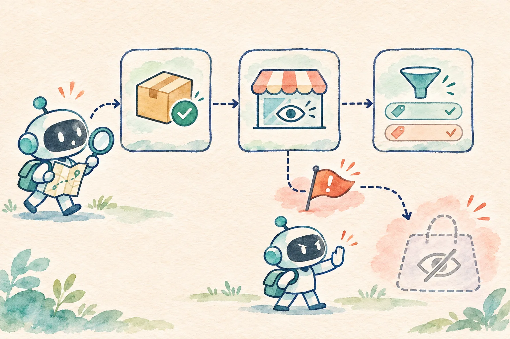

## “已上架”为什么还不能回答“用户看得见”

运营同学在后台看到一件商品的状态是“已上架”，但前台列表里没有它，于是问 Agent：“商品去哪了？”如果助手只查商品目录，就很容易回答“已经上架，请刷新页面”。这个回答跳过了至少两道关口：店铺的展示规则是否放行，以及用户当前选的分类是否会把它过滤掉。更进一步，即使这三项条件都满足，搜索索引和缓存也可能尚未同步。**上架是一个证据，可见是另一个结论。**

这篇做一个 Vue 3 + TypeScript 的最小演示：用户选一个故障场景和分类筛选，点击“查询并核对”；页面并列展示商品目录和展示规则的只读结果，Agent 只根据本轮证据给出阶段性解释。虚构商品编号是 `MUG-DEMO-17`，目录版本为 `v4`，演示时钟固定为 **2026-11-13 20:00（北京时间）**。所有记录、工具错误和 `mockCandidate()` 都是预设样本，没有真实模型调用，也不连接商家后台。



## 页面交互：把三道关口放在同一屏

页面顶部有“商品与规则场景”和“页面分类筛选”两个选择框。默认场景里，目录记录为已上架，展示规则启用，页面选择“全部分类”，因此回答是“满足本轮展示条件”。把分类改成“户外”，同一件杯具会被当前筛选排除。切成“商品仍是草稿”时，只需要目录记录就能解释尚未上架；展示规则结果不作为该结论的引用。

两个本地只读工具同时启动，再用 `Promise.allSettled()` 分别收集完成或失败状态。[MDN 文档](https://developer.mozilla.org/en-US/docs/Web/JavaScript/Reference/Global_Objects/Promise/allSettled)说明，它等待所有输入 Promise 结束，并按输入顺序返回各自的结果。这样规则查询超时不会抹掉已查到的上架记录；页面仍可说“已上架”，但必须把“展示状态”标为未知。

```ts
const [catalog, rule] = await Promise.allSettled([
  readCatalog(scenario),
  readRule(scenario)
])
return {
  catalog: catalog.status === 'fulfilled'
    ? { ok: true, value: catalog.value }
    : { ok: false, reason: 'not_found' },
  rule: rule.status === 'fulfilled'
    ? { ok: true, value: rule.value }
    : { ok: false, reason: 'timeout' }
}
```

这里的 `not_found` 和 `timeout` 只来自固定演示场景，不能照抄为生产错误映射。真实接口须区分未找到、权限拒绝、服务故障和超时；用户或运营人员的商品访问权限也必须在服务端验证。目录记录查不到时，本例不展示独立返回的展示规则，避免把没有核实归属的规则贴在当前商品上。

| 证据 | 本例能说明 | 单独不能说明 |
| --- | --- | --- |
| `catalog.read` | 商品是否为草稿、目录版本、分类 | 展示规则已放行、搜索已收录 |
| `visibility.read` | 演示展示开关、关联目录版本 | 用户当前筛选命中、缓存已同步 |
| 页面筛选快照 | 当前选择“全部/杯具/户外” | 后端实际搜索结果、其他用户看到的内容 |

## 核对版本、时间和筛选快照

结果组合前先比对商品 `sku` 和目录版本。规则如果关联 `v3`，而目录已经是 `v4`，两份记录就不能当成同一轮状态；页面显示“记录版本不一致”，建议重查或人工核对。演示还要求查询时间距固定时钟不超过五分钟。五分钟只是为了把“过期证据”做成可重复测试的样本阈值，不是生产建议。真实系统应按索引刷新、缓存和规则发布的实际契约设置时效。

```ts
if (rule.sku !== catalog.sku || rule.catalogVersion !== catalog.version) {
  return 'conflict'
}
if (!rule.enabled) { return 'rule_block' }
if (filter !== 'all' && filter !== catalog.category) { return 'filter_miss' }
return 'visible'
```

“visible”在代码里的含义是**这三项演示条件满足**，并不是浏览器已经向某个真实用户展示了商品。示例根本没有搜索索引、投放、缓存或客户端埋点工具，回答也明确保留这条边界。若用户在查询后改了分类，Vue 页面版本加一，旧回答立即标为失效；重新查询才会按新筛选解释。

## 固定模拟回答也必须核验引用

`mockCandidate()` 返回固定结论、来源 ID 和一句占位消息，模拟 Agent 生成候选。`verify()` 不把占位消息直接显示给用户，而是根据工具快照独立计算可接受状态，再检查候选引用是否恰好是本轮允许的来源。若候选插入 `publish.write#fake`，或把“规则未放行”说成“满足展示条件”，页面拒绝该主张。这个设计演示了**回答与证据分离**：语言层可以提出解释，最终展示必须经过确定性校验。

[TypeScript 官方的类型收窄文档](https://www.typescriptlang.org/docs/handbook/2/narrowing)解释了判别联合类型如何让代码在检查字段后收窄分支。本例的工具结果采用 `{ ok: true, value } | { ok: false, reason }`，访问 `value` 前必须检查 `ok`。[Vue 官方 TypeScript Composition API 指南](https://vuejs.org/guide/typescript/composition-api)展示了带类型的 `ref()`；示例分别用 `ref<Snapshot | null>` 和 `ref<Answer | null>` 保存证据与回答。模板只进行文本插值，不把候选消息作为 HTML 注入。

这个校验是教学上的最小层。来源 ID、版本号和筛选快照都存在静态前端里，用户可以改浏览器脚本，因此它们不承担真实授权或审计职责。接入真实业务时，应由服务端核实店铺和商品归属，保存可追踪的请求 ID，并根据实际目录、规则、索引、缓存和投放服务的契约设计排查链路。此处不自动修改任何上架或展示设置。

## 下载并跑通成功与失败场景

[打开静态演示](/examples/agent-product-visibility-diagnosis/)或[下载完整源码 ZIP](/examples/agent-product-visibility-diagnosis/source.zip)。ZIP 包含已构建的 `index.html`、`app.js`、`style.css`；解压后进入目录，运行：

```bash
python3 -m http.server 8100 --bind 127.0.0.1
```

然后打开 `http://127.0.0.1:8100/`，无需模型密钥。想修改源码时，使用 Node.js 22 或更新版本执行 `npm ci`、`npm run typecheck`、`npm test`、`npm run build`；首次安装依赖可能需要访问 npm 注册表。

先查默认场景，应看到“满足本轮展示条件”，但不承诺真实搜索已同步。接着选择“户外”分类，应得到“被当前筛选条件排除”。“商品仍是草稿”和“展示规则未放行”要指出不同关口；“规则查询超时”只能保留已上架这一部分事实；“版本不一致”“证据过期”“商品记录未找到”都不能给出可见承诺。勾选伪造引用，或查询后改变页面状态，可以观察旧结论被拒绝。

本地固定夹具通过 **22 项离线断言**，并完成 TypeScript 检查、静态构建和浏览器布局检查。这些结果只证明演示代码对预设样本的处理，不是生产商品排查，也不是模型评测。实际落地还要验证真实权限、索引与缓存、错误码、规则发布延迟和人工处理路径。Agent 在前端的价值，是把已知的每道关口、尚未核实的关口和下一步排查动作讲清楚。
