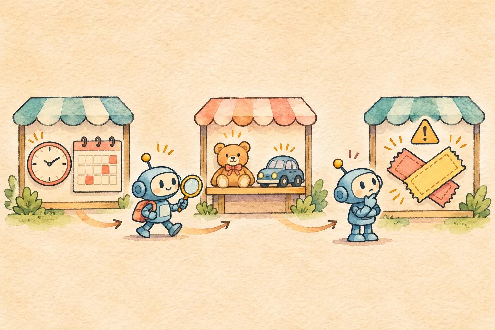

## 活动上线前，先把“可以发布”拆开

运营准备给一款杯具做周末活动：后台草稿里已经填了开始和结束时间，选了商品，还勾选“可叠加优惠券”。如果 Agent 只看到活动草稿存在，就回答“可以上线”，可能遗漏三个独立问题：时间是否写反、商品是否属于活动适用范围、优惠券规则是否允许叠加。更危险的是，它可能把昨天读到的券规则和今天修改过的活动草稿拼在一起。

这篇用 Vue 3 + TypeScript 做一个**只读预检 Agent**。页面让运营选择场景，点击“查询并预检”，同时展示活动、商品、优惠券三份证据和本轮结论。虚构活动是 `ACT-DEMO-41`，商品是 `MUG-DEMO-17`；演示时钟固定在 **2026-11-14 20:00（北京时间）**。所有数据、工具故障和 `mockCandidate()` 都是固定样本。代码没有真实模型调用、商家接口、付款、对外消息，也没有“发布活动”的写工具。



## 同一屏里核对三种证据

[打开静态演示](/examples/agent-promotion-preflight-check/)后，默认选中“时间、商品与叠加规则均通过”，勾选“计划叠加演示优惠券”，点击“查询并预检”。左侧能看到活动 r7 的时间窗、商品适用状态、券规则关联的活动版本和各自来源 ID；右侧给出“本轮预检通过”。这里的“通过”只表示**这三道固定演示关口通过**，绝不表示活动已经发布，更不替代真实后台的最终校验。

页面还提供“活动开始晚于结束”“商品不适用”“优惠券不可叠加”“券规则查询超时”“券规则引用旧版活动”“证据过期”和“活动记录未找到”。这些不是同一种错误：时间写反和商品不适用需要修改草稿；查询超时只允许说“尚未核实”；版本不一致需要重新读取；活动记录缺失则不能据此推断真实系统中不存在活动。

| 本轮来源 | 能确认的事 | 不能单独确认的事 |
| --- | --- | --- |
| `activity.read` | 时间窗、商品编号、草稿版本 | 商品可参加、优惠券可叠加 |
| `product.read` | 演示商品资格和关联版本 | 活动时间有效、券规则可用 |
| `coupon.read` | 演示券叠加规则和关联版本 | 商品资格、最终发布状态 |

三个工具返回独立结果。示例使用 [`Promise.allSettled()`](https://developer.mozilla.org/en-US/docs/Web/JavaScript/Reference/Global_Objects/Promise/allSettled)等待所有只读查询，并按输入顺序保留每个结果。券规则超时时，已查到的活动和商品证据仍可显示，但结论必须停在“部分未知”，不能用默认允许叠加来填补空白。

```ts
const [activity, product, coupon] = await Promise.allSettled([
  readActivity(scenario),
  readProduct(scenario),
  couponRequested ? readCoupon(scenario) : Promise.resolve(null)
] as const)
```

真实服务不能把所有异常都粗略写成“超时”。本例的缺失和超时是由固定场景主动制造的；接入接口时应分别处理权限拒绝、资源不存在、网络故障、限流和业务规则拒绝。若活动记录没有读到，页面也不展示独立返回的商品和券判断，避免把孤立数据误贴到当前活动。

## 时间、版本和证据新鲜度一起看

活动时间是带 `+08:00` 时区偏移的 ISO 字符串。用 `Date.parse()` 转成时间戳后，先确认开始和结束均有效，再检查开始严格早于结束。[MDN 的 `Date.parse()` 文档](https://developer.mozilla.org/en-US/docs/Web/JavaScript/Reference/Global_Objects/Date/parse)说明了日期字符串的解析行为；没有时区偏移的日期时间可能按运行环境本地时区解释。因此这个演示显式写入偏移，不依赖浏览器所在城市。

```ts
const start = Date.parse(activity.startsAt)
const end = Date.parse(activity.endsAt)
const validWindow = Number.isFinite(start)
  && Number.isFinite(end)
  && start < end
```

下一步比对 `sku` 和活动版本。商品资格与券规则都必须关联活动 r7；只要券规则仍指向 r6，本轮就显示“记录版本不一致”，不会把两代记录拼成上线建议。查询时间也要落在演示时钟之前五分钟内。**五分钟仅是可重复测试的夹具阈值**，不是生产系统的通用 SLA；真实时效应由活动、商品和券服务的更新契约决定。

“模拟修改活动草稿”按钮会把页面版本从 r7 改成 r8。即便旧工具结果刚刚返回，它也不能替新页面背书，回答会标为失效。Vue 的 `ref<Snapshot | null>` 和 `ref<Answer | null>` 分别保存证据与回答；[Vue 官方 TypeScript 指南](https://vuejs.org/guide/typescript/composition-api)给出了这种 `ref()` 类型写法。查询时还记录请求序号，页面状态变更后丢弃过时响应，避免旧请求覆盖新结果。

## 候选回答不能自己给自己作证

`mockCandidate()` 根据固定快照生成一个候选结论、来源 ID 列表和占位消息。它**不调用模型**；占位消息也不直接渲染。`verify()` 独立计算预检状态，要求候选状态和引用列表都与本轮可用证据完全一致，再从受控文案表生成显示文字。勾选“注入伪造引用”会给候选加上 `publish.write#fake`，页面立即拒绝显示该主张。

```ts
if (candidate.verdict !== expected.verdict ||
    candidate.sourceIds.length !== expected.sourceIds.length ||
    candidate.sourceIds.some((id, index) => id !== expected.sourceIds[index])) {
  return { verdict: 'conflict', sourceIds: [], headline: '候选回答未通过核验' }
}
```

工具结果类型写成 `{ ok: true, value } | { ok: false, reason }`。检查 `ok` 后才读取 `value`，对应 [TypeScript 官方“类型收窄”文档](https://www.typescriptlang.org/docs/handbook/2/narrowing)中的判别联合类型思路。这能减少前端遗漏失败分支，却不能让浏览器里的来源 ID 成为可信审计证据。真实落地必须在服务端核实操作者权限、商品和券的归属，记录请求 ID、版本与规则来源；若需要执行发布，还必须另设授权、复核和幂等写入流程。本演示只到“解释预检结果”为止。

## 下载、运行与验证

[下载完整源码 ZIP](/examples/agent-promotion-preflight-check/source.zip)。包里已经有 `index.html`、`app.js`、`style.css`，解压并进入目录后运行：

```bash
python3 -m http.server 8100 --bind 127.0.0.1
```

浏览器打开 `http://127.0.0.1:8100/`，无需 API 密钥。修改源码时，使用 Node.js 22 或更新版本依次执行 `npm ci`、`npm run typecheck`、`npm test`、`npm run build`；首次安装依赖可能需要访问 npm 注册表。

建议按四组操作检查：① 默认场景应显示三份引用和“本轮预检通过”；② 把时间写反、商品设为不适用、券设为不可叠加，应分别显示不同的修正原因；③ 券超时、旧版本、过期证据和活动缺失，不应给出完整通过结论；④ 注入伪造引用或在查询后修改页面草稿，旧结论应被拒绝或失效。没有申请叠加券时，回答必须明确说“未核对券规则”。

固定夹具通过 **29 项离线断言**，并完成 TypeScript 检查、静态构建和桌面、手机页面检查。这些只证明示例对预设输入的行为，不是模型评测、真实业务验证或上线许可。一个能落地的前端 Agent，应把每个结论所依赖的证据、未查到的条件以及下一步人工动作清楚地放在页面上。
