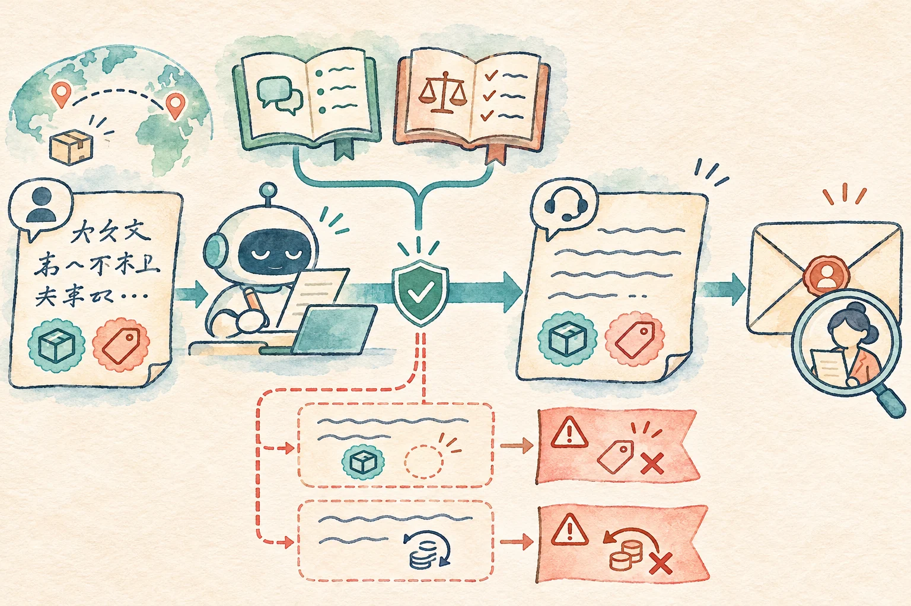

## 翻译客服回复，先确定哪些内容不能被改

跨境店铺的客服要把一段中文回复翻成英文。源文写着：“订单 `ORD-DEMO-42` 的 `$29.90` 商品有划痕。请客户在订单页提交售后申请；我们会在人工核实后反馈结果。”如果 Agent 把金额改成 `$39.90`，漏掉订单号，或把“人工核实后反馈”翻成“退款已批准”，流畅的英文反而会制造新的客服事故。

这篇用 Vue 3 + TypeScript 做一个**只生成待审阅译文**的最小页面。它先保护订单号与金额，再读取术语表和售后规则，随后检查固定模拟翻译候选是否保留关键字段、引用本轮证据、避开未获授权的退款承诺。[打开交互演示](/examples/agent-cross-border-reply-translation/)可切换七种情况；[下载完整源码](/examples/agent-cross-border-reply-translation/source.zip)可离线运行。源文、工具结果与候选回复均为虚构夹具，没有真实翻译模型、订单 API、客服发送或退款操作。



## 页面上并排展示三层内容

客服首先看到中文源文和“给模拟翻译器的遮盖版”。订单号、金额分别变成 `⟦ORDER⟧`、`⟦AMOUNT⟧`；遮盖版不含原值。下方列出术语和政策的读取状态：术语表规定“售后申请”写作 `after-sales request`、“人工核实”写作 `manual review`；演示政策只允许引导客户提交申请，明确没有批准退款。右侧是最终英文草稿和来源 ID，状态分为 `ready`、`blocked`、`stale`、`rejected`。

这个布局让审阅者能直观看见三件不同的事：源文实际说了什么、只读工具提供了什么、候选译文准备说什么。来源 ID 是本地夹具编号，不是真实业务系统的证据链接。真实产品还要按客服角色控制原始订单和政策的访问权限，并限制日志、浏览器缓存及模型请求中出现的敏感字段。

顺序也很重要：先读取并锁定源文版本，再处理敏感字段，最后才取得候选译文。若把遮盖动作留到模型回复之后，错误金额可能已经进入生成结果；若只在页面显示时恢复字段，却没有校验候选是否漏掉占位符，客服仍可能复制出一段信息不全的英文。示例把这些关口拆成独立函数，方便逐个测试和解释失败原因。

| 本轮来源 | 演示里允许使用的内容 | 缺失时的处理 |
| --- | --- | --- |
| 中文源文 r1 | 原订单号、原金额和处理措辞 | 版本变更则重读，旧译文失效 |
| `glossary.read` | 两个固定英文术语 | 停止生成对外草稿 |
| `policy.read` | 可引导申请，未批准退款 | 停止生成对外草稿 |

术语和政策互不依赖，示例使用 [`Promise.allSettled()`](https://developer.mozilla.org/en-US/docs/Web/JavaScript/Reference/Global_Objects/Promise/allSettled)等待两项只读操作完成，分别显示成功或超时。MDN 文档说明结果数组按传入任务顺序排列，即使完成顺序不同也不会把政策结果贴到术语栏。这里的 `Promise.reject()` 只用来制造可重复的超时场景，**不是实际网络故障**。

## 用占位符保护原值，再校验完整性

`protect()` 只识别这个教学案例中的演示订单号格式 `ORD-DEMO-数字` 和美元金额格式 `$数字.两位小数`。它要求恰好有一个订单号、一个金额，然后分别替换成唯一占位符。示例代码中，这一步发生在调用 `mockCandidate()` 之前，模拟函数只接收遮盖版字符串和修订号；真实模型接入时应在服务端完成遮盖与恢复，不应让浏览器单独承担敏感信息保护。

```ts
const masked = source.text.replace(/ORD-DEMO-\d+|\$\d+\.\d{2}/g, value => {
  return value.startsWith('$') ? '⟦AMOUNT⟧' : '⟦ORDER⟧'
})
```

候选英文只能携带这两个占位符，不能直接写入另一个金额或订单号。校验器用全局正则与 [`String.matchAll()`](https://developer.mozilla.org/en-US/docs/Web/JavaScript/Reference/Global_Objects/String/matchAll)统计占位符：两种都必须各出现一次，不能多也不能少。MDN 说明 `matchAll()` 返回可遍历匹配结果，正则需要 `g` 标志。通过校验后才把占位符恢复为源文原值；未知占位符会被拒绝。

这只是对**明确列出的字段格式**做完整性检查。实际订单号、币种、金额写法可能更多；正则漏掉的字段不会被自动保护。生产系统应该用结构化业务字段而不是从自由文本猜测所有敏感内容，并让服务端把源文版本、保护映射和恢复结果绑定到同一次任务。

## 术语和政策不能靠候选自己作证

`mockCandidate()` 返回一段固定英文、源文修订号和两个来源 ID，模拟一次模型响应；它不调用 AI 服务。`verify()` 独立核对本轮术语和政策是否读取成功，候选引用是否逐项匹配，源文修订号是否仍是当前版本。任何一项失败，页面不展示可审阅草稿。工具结果用 `kind: 'ok' | 'timeout'` 的联合类型表示；[TypeScript 类型收窄文档](https://www.typescriptlang.org/docs/handbook/2/narrowing)说明了按判别字段访问不同分支的方式。

```ts
if (source.revision !== currentRevision) return stale('源文已更新')
if (glossary.kind !== 'ok' || policy.kind !== 'ok') return blocked('证据未读到')
if (candidate.sourceIds.some((id, i) => id !== expectedSources[i])) {
  return rejected('引用不匹配')
}
```

这个固定示例还禁止候选包含 `refund` 或 `approved`，因为源文与演示政策都没有给出退款批准信息。候选换成“Your refund has been approved.”时，页面立即显示 `rejected`，不会把该句放进回复区。这个词项规则是当前夹具的保守关口，**不能证明语义等价**：模型可能用别的词表达同样的承诺，也可能虽保留术语和占位符却误译上下文。因此最终译意、礼貌程度和政策适用性必须由人工审阅。

引用同样只能证明“使用了哪份记录”，不能证明译文已经正确理解记录。示例要求候选提供两项来源，页面从当前工具结果独立计算预期来源并逐项比较。真实系统还应把来源 ID、版本、权限和引用片段绑定在服务端，避免候选通过自报一个看起来正确的编号就获得信任。

## 让失败状态告诉客服下一步

默认情况可以得到一段英文待审阅草稿；订单号和金额均恢复为源文值，两个证据来源同时展示。切换“候选遗漏金额占位符”或“候选擅改金额”，校验器拒绝草稿，避免数字悄悄变化。“候选擅自承诺退款”同样被拒绝。术语或政策超时时，状态是 `blocked`，提示先恢复证据，而不是把“没查到”当成“允许”。

“源文版本变化”用于模拟翻译过程中客服修改了中文回复：旧候选不能被当作新源文的译文。页面另有“模拟源文更新”按钮，它增加修订号并清空上一轮结果；迟到的旧任务也会因请求序号不一致而被丢弃。Vue 的 [`ref()` 类型用法](https://vuejs.org/guide/typescript/composition-api)让 `Evidence | null` 与 `Assessment | null` 明确表示“未读到”和“尚未生成”，避免旧草稿留在新场景里。

页面上的“人工已审阅译意”只改变本地复选框。**没有发送按钮，也没有对外消息接口**；勾选不会通知客户或创建退款。真实发送流程还需要独立的权限校验、人工确认、服务端记录与发送结果核对。这篇仅演示前端如何把核对点和失败原因摆到审阅者面前。

## 运行示例与验证边界

下载源码包，使用 Node.js 22 或更新版本：

```bash
npm ci
npm run typecheck
npm test
npm run build
python3 -m http.server 8765
```

打开 `http://127.0.0.1:8765/`。`npm test` 在固定数据下验证占位符、原金额恢复、来源、政策超时、术语超时、源文版本和无依据退款承诺等关口。离线测试和静态页面演示只证明这些明确断言成立；它们**不是**真实模型质量评测，也不能覆盖不同语言、汇率、法律条款或生产客服规则。若要接入真实模型，先补充多语言人工标注样本、服务端审计与人工发布审批，再逐步扩大覆盖范围。

翻译 Agent 帮忙起草可以减少重复输入，但用户真正需要的是一份能安全审阅的回复。前端把源文、受保护字段、证据和待审阅译文放在同一屏，正是让人工判断有依据可查。
