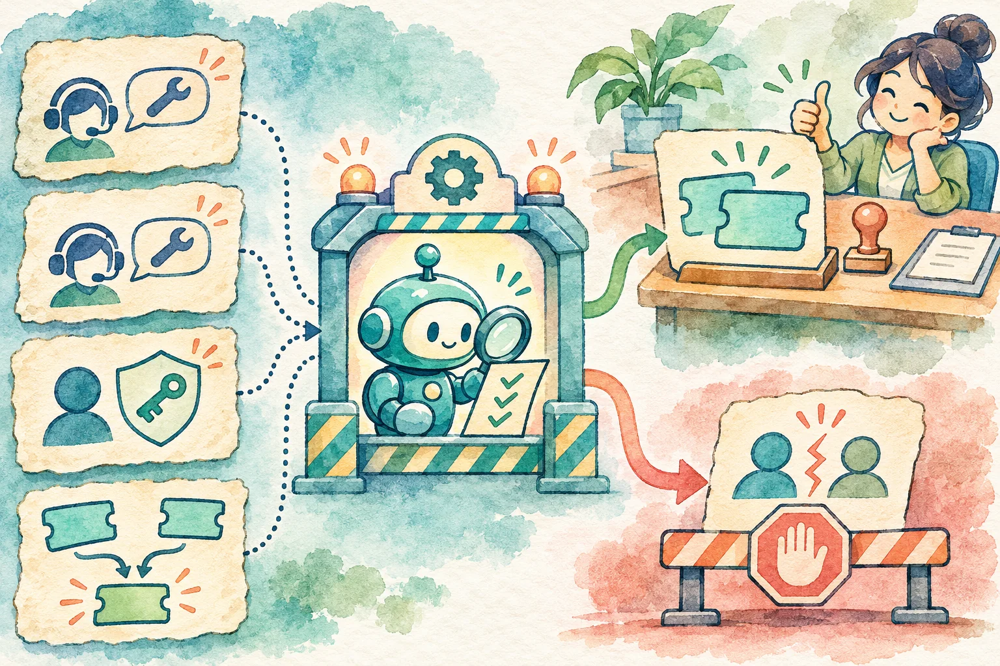

## 两条相似消息，未必是同一张工单

客服工作台里出现两张工单：`T-DEMO-41` 说“物流停在分拨中心，询问预计送达时间”，`T-DEMO-42` 说“同一订单的物流进度仍没有更新”。Agent 很容易给出“重复，合并吧”。但页面若直接执行合并，可能把另一位客户的工单串进来，也可能把不同订单、不同问题或已经关闭的记录当成同一件事。合并会影响客服后续处理轨迹，不能只凭两段文字相似。

这篇用 Vue 3 + TypeScript 做一个**只生成待人工审阅合并建议**的前端示例：[打开交互示例](/examples/agent-duplicate-ticket-review/)可切换 12 种固定情况，[下载完整源码](/examples/agent-duplicate-ticket-review/source.zip)可运行离线断言。工单、账户、规则和 Agent 候选都是虚构夹具。示例没有调用真实模型、客服系统、合并接口、关闭接口或对外消息接口，也没有声称实际减少了多少工单。



## 先把“能否读取”放在工具边界

页面并行取得三份只读证据：`tickets.readPair` 返回当前演示账户可见的两张工单；`account.read` 返回账户与允许访问的工单编号；`policy.read` 返回这篇教学示例的合并建议规则。`Promise.allSettled()` 让页面分别显示每项读取的成败；[MDN 文档](https://developer.mozilla.org/en-US/docs/Web/JavaScript/Reference/Global_Objects/Promise/allSettled)说明，结果按传入 Promise 的顺序排列，即使各任务完成顺序不同，也不会把工单证据当成政策证据。

最重要的一步在读取工具内部：示例的 `readTickets()` 先检查两张工单是否属于当前演示账户，再返回内容。“另一账户的工单”场景会让这个工具拒绝，页面只显示通用失败信息，**不展示第二张工单的摘要**。这是为了演示鉴权应发生在读取数据之前。[OWASP 关于 IDOR 的说明](https://cheatsheetseries.owasp.org/cheatsheets/Insecure_Direct_Object_Reference_Prevention_Cheat_Sheet.html)明确把支持工单列为需逐对象检查权限的例子；仅使用不易猜的编号，不能代替对象级访问控制。

```ts
// readTickets() 构造固定虚构夹具后、返回数据前：
if (first.accountId !== sessionAccountId || second.accountId !== sessionAccountId) {
  return Promise.reject(new Error('not authorized'))
}
return Promise.resolve({ first, second, sourceId: `tickets.read#pair@r${actualRevision}` })
```

这段代码只是本地夹具的边界示意。真实服务端不能信任浏览器传来的 `sessionAccountId`；它应从已验证会话识别用户，并对每张工单执行授权查询。前端即使再次比较账户 ID，也不能补救服务端已经把越权内容发到浏览器的问题。页面中的 `account.read` 结果则是第二道演示性核对，不是权限的唯一来源。

## 候选只提建议，字段要重新核对

本例的 Agent 候选是一段固定模拟 JSON：`decision: suggest_merge`、主次工单 ID、两张工单的修订号、三项来源 ID。它没有自由文本理由，也没有“执行合并”的动作。`parseCandidate(unknown)` 先在运行时验证字段类型、长度、编号格式与修订号；TypeScript 的类型声明无法让真实模型输出自动变成可信数据。[TypeScript 的类型收窄文档](https://www.typescriptlang.org/docs/handbook/2/narrowing.html)解释了如何用运行时检查区分不同形状的数据，本例进一步把结构错误直接标为 `rejected`。

结构通过之后，`verify()` 从**本轮已读取证据**重新计算预期来源，而不是相信候选自报。候选把 `policy.read#merge@r2` 换成看似类似的 `policy.read#other@r2`，结果是 `rejected`；主次工单颠倒也一样。页面生成的理由由已核对字段拼成，不采纳候选的主观描述。这让客服能看见“建议关联哪两张工单”和“依据来自哪里”，而不是只看一句没有出处的结论。

```ts
const expectedSources: [string, string, string] = [
  sourceId, ownership.sourceId, policy.sourceId
]
if (candidate.sourceIds.some((id, index) => id !== expectedSources[index])) {
  return result('rejected', '候选引用与本轮证据不一致。')
}
```

来源 ID 是固定夹具标识，并非真实系统的可验证引用链接。生产环境还要把来源、权限、工单版本和被引用的片段放在服务端审计记录中。即便三项来源一致，也只能说明“候选引用了当前记录”，不能证明两位客服对客户诉求的理解一定相同。

## 用状态告诉客服为什么不能合并

示例规则很保守：两张工单必须属于同一账户、同一订单、同一问题类型，并且都处于 `open`。默认情况得到 `ready`，但标题仍叫“合并建议草稿”，人工复选框只改变本地界面。换成不同订单、不同问题或已关闭工单，状态是 `rejected`，页面保留两张独立记录；任一只读工具超时则是 `blocked`，不把“没查到”解释为“允许”；工单修订号变化则是 `stale`，提示重新读取。

这些状态不是一套通用工单合并政策。现实里，同一订单也可能同时有“延迟送达”和“商品破损”两件独立问题；反过来，同一问题也可能跨多个订单。问题代码相同只是可核对线索。真正的合并决策还需客服阅读完整会话、检查是否已有不同处理人和 SLA，并确认不会丢失消息、附件或责任归属。本例故意停在人工审阅前，没有提交按钮。

| 页面状态 | 触发例子 | 客服下一步 |
| --- | --- | --- |
| `ready` | 本轮三项证据和候选一致 | 人工审阅两段诉求，仍未合并 |
| `blocked` | 越权读取或某项工具失败 | 先恢复授权或查询，不查看受限内容 |
| `stale` | 工单或候选修订号落后 | 重新读取并核对最新内容 |
| `rejected` | 订单不同、已关闭或引用伪造 | 分开处理或修正候选 |

这个状态表也给前端一个清晰的渲染约束：只有 `ready` 才展示完整的建议卡片；其他状态只显示原因和下一步。错误态不应把上一轮已经勾选的“人工已审阅”保留下来，也不应在工具超时后悄悄使用本地缓存的旧来源。否则界面虽然写着“失败”，旁边还留着绿色建议，很容易让人误以为可以继续操作。

Vue 侧用 `ref<Collected | null>` 与 `ref<Assessment | null>` 表示尚未取得证据和尚未形成结论。[Vue 官方 TypeScript 文档](https://vuejs.org/guide/typescript/composition-api#typing-ref)说明了 `ref()` 的显式类型写法。切换场景或点击“模拟工单更新”会清空旧证据、旧建议和人工复选框；请求序号阻止迟到的旧读取结果覆盖新页面。它只保护当前浏览器视图，**不能撤销服务器上的写操作**，所以真实合并仍必须由服务端在提交时重新检查权限、版本和幂等结果。

## 运行示例与离线验收

解压源码包后使用 Node.js 22 或更新版本运行：

```bash
npm ci
npm run typecheck
npm test
npm run build
python3 -m http.server 8765
```

打开 `http://127.0.0.1:8765/`。先试“同一问题，证据齐全”，核对两张虚构工单与三项来源；再试“另一账户的工单被拒绝读取”“问题类型不同”“工单版本已变化”和“候选伪造规则来源”。`npm test` 使用固定数据检查成功、跨账户隐藏、订单与问题冲突、关闭状态、工具超时、版本过期、候选结构错误及来源伪造等分支。测试结果仅是离线断言，**不是**真实模型的工具选择能力、客服语义判断或生产权限测试。

如果未来接入真实模型，可以保留“候选只建议、证据独立读取、服务端再核验”的分层：先让模型挑出可能重复的工单，再由有权限的只读服务返回相关证据；人工确认后，后端按当前版本执行可审计的合并，并查询最终状态。那是后续工程设计，不是本文已经实现的功能。本文能展示的最小成果，是在前端把建议与证据、失败原因和人工决定放在同一屏，让错误的候选有明确的停止位置。
