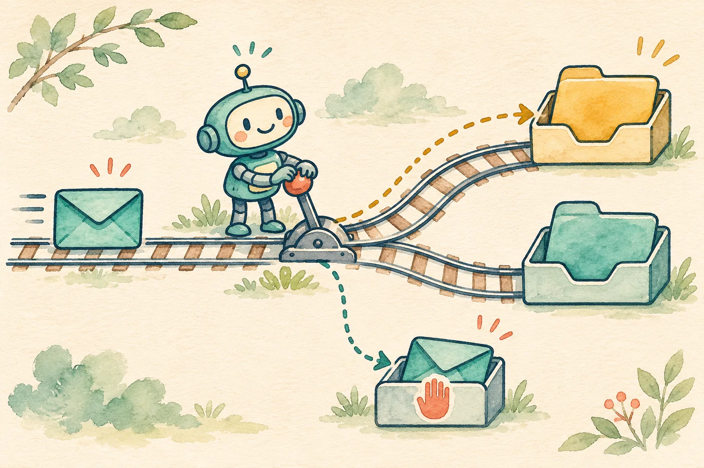

## 客服切换到下一位客户时，上一条任务还在跑

客服先在客户 A 的配送会话查询物流，等工具返回期间切到客户 B 的退货会话。几秒后，A 的物流结果到了。如果两个会话共用一个 `draft` 字段，A 的答复就可能显示在 B 的工单旁。这个错误在单会话里很难复现，客服却可能在高峰期同时等多笔查询，把出现在眼前的草稿当成当前客户的答案。

今天的工作台允许客服在后台等结果。A 的查询返回时，结果进入 A 的配送会话，B 的草稿区继续显示 B 的状态。客服切回 A 才会看到 A 的草稿。若 A 已在配送会话发起第二次查询，系统只采纳较新的任务；若工作区已重置，原工作区的任务返回后直接失效。

[打开交互示例](/examples/agent-conversation-response-routing/)或[下载源码](/examples/agent-conversation-response-routing/source.zip)，可以手动决定每个结果的到达顺序。三个会话、回复内容和工具失败都来自本地固定样本，示例只生成本地草稿。真实模型调用、客服数据读取与消息发送均未接入。



## 比较三种身份

第一种身份是**当前可见的会话**。它只决定右侧草稿区读哪条记录。第二种身份是**任务创建时的会话**。启动时同时记录客户和会话编号，后续响应按这组字段定位原记录。第三种身份是**会话内最新任务**。在同一会话连续发起查询时，已经被覆盖的任务失去写入资格，即使返回内容本身是有效的。

| 演示会话 | 客户 | 会话编号 | 草稿示例 |
| --- | --- | --- | --- |
| 客户 A · 配送 | A | 1 | 包裹正在中转 |
| 客户 A · 发票 | A | 2 | 发票状态待人工核对 |
| 客户 B · 退货 | B | 1 | 申请已收到，等待审核 |

两个客户都可能拥有编号为 1 的会话，而同一个客户也可能同时处理配送和发票。要把草稿独立保存，最小示例用 `JSON.stringify([customer, conversation])` 生成字符串键，再放进 `Map`。这也避免用对象本身当键时遇到的问题：两个字段值完全相同的新对象，在 `Map` 里仍是两个不同的引用。参见 [MDN 对 Map 键相等性的说明](https://developer.mozilla.org/en-US/docs/Web/JavaScript/Reference/Global_Objects/Map#key_equality)。

## 结果总是先找到原来的任务

点击“启动任务”时，程序保存一份任务记录，包含 `scope`、`workspaceVersion` 和递增的 `id`。待投递列表里的每一项都持有这份记录。实现真正的工具调用时，这份记录可以由发起请求的闭包持有，也可以由前端通过服务端分配的任务 ID 找回来。关键是收到回复时能找到自己的任务记录，避免拿页面当前选中的客户去补填结果。

处理结果分三步。先核对任务属于当前工作区版本，再查它对应的原会话，确认该会话最新状态仍在等这项任务。最后把响应当作 `unknown`，检查客户、会话、任务编号和内容字段。传入结果的身份只能和本地任务记录比对，不能决定目标会话。若某个结果声称属于另一个客户，当前任务以“返回结构或归属不符”结束，另一个客户的草稿保持自己的状态。

```ts
function finish(run: Run, raw: unknown): Delivery {
  if (run.workspaceVersion !== workspaceVersion) return 'expired_workspace'
  const key = scopeKey(run.scope)
  const entry = entries.get(key)
  if (entry?.status !== 'pending' || entry.id !== run.id) return 'superseded'

  const reply = parseReply(run, raw)
  if (reply?.kind === 'ok') {
    entries.set(key, { status: 'ready', id: run.id, draft: reply.draft })
    return 'ready'
  }

  const reason = reply?.kind === 'tool_error' ? 'tool_error' : 'invalid_response'
  entries.set(key, { status: 'error', id: run.id, reason })
  return reason
}
```

`Entry` 以 `status` 区分等待、草稿可见和失败。Vue 模板只在结果可用时取 `draft`，只在错误状态读 `reason`。TypeScript 会按照字面量字段收窄联合类型，运行时的 `parseReply()` 再负责识别真实接口可能返回的空字符串、字段类型变化和不匹配的身份。参见 [TypeScript Handbook 的判别联合](https://www.typescriptlang.org/docs/handbook/2/narrowing.html#discriminated-unions)。

## 后台结果只更新它自己的会话

界面先更新数据，再从当前会话读取要展示的内容。`computed()` 用选中的索引取得当前会话；切换会话、启动任务、收到结果或重置后，`syncVisibleEntry()` 都会从 `Map` 重新取当前记录。这里的 `Map` 由纯 TypeScript 逻辑管理，Vue 只维护当前可见记录的 `ref`。这样离线测试可以直接调用 `finish()` 检验数据归属，再到浏览器验证页面实际显示。参见 [Vue 响应式 API 中的 computed](https://vuejs.org/api/reactivity-core.html#computed)。

同一次配送查询有时会因为重连收到两次完成通知。第一次把记录移到 `ready`，第二次找不到对应的 `pending` 状态，会被记录为已完成或已替代。更常见的是客服点击重试，新的任务先返回。按会话核对最新编号后，旧成功和旧失败都无法覆盖新结果。与此同时，A 的下一次配送查询也不会覆盖 A 的发票会话。

当客服退出工作区或会话范围改变，真实产品需要按权限刷新可见记录。演示把这一动作简化成“重置工作区”，增加工作区版本并清空草稿存储。待投递列表还留着匿名旧任务按钮，让读者可以模拟中断后仍有回调到达。按下按钮只会产生“工作区已重置”的记录，旧回复内容和会话标签不会重新出现在页面。

## 投递顺序可以手动控制

解压源码后运行以下命令，再打开 `http://127.0.0.1:8765/`。源码包也带有已构建的 `app.js`，可以直接在浏览器里打开 `index.html`。

```sh
npm ci
npm run typecheck
npm test
npm run build
python3 -m http.server 8765
```

先在 A 的配送会话启动任务 #1，切到 B 的退货会话启动 #2。留在 B，投递 #1，右侧仍显示“等待任务 #2 返回”。投递 #2 后可看到 B 的退货草稿，切回 A 则会看到刚刚保存的配送草稿。还可以在 A 的发票会话跑一遍，观察它使用自己的记录。

然后回到同一个会话连续启动两个任务，先交付新的，再交付旧的，右侧会保留新的草稿。下拉菜单可以模拟工具失败、响应归属不符、字段类型错误。重置工作区后再投递旧任务，可以检查它不会恢复已清除的草稿。`npm test` 使用固定结果核对这些边界，包括重复投递、重试后的旧失败和重置后的旧回调。测试衡量的是状态处理逻辑，生产环境中的传输、权限和模型判断需要各自验证。

## 接到真实客服系统时

后台是否继续执行取决于客服流程。纯查询可以允许后台完成，客服切回来时继续阅读；当用户关闭工具或任务代价较高，可以在请求层增加取消通知。Vue 的 watcher 支持为失效请求注册清理回调，浏览器 `AbortController.abort()` 可以终止支持该信号的 fetch、响应体读取和流。后台服务是否已经受理任务，需要由它自己的取消协议或状态查询来确认。参见 [Vue watcher 清理文档](https://vuejs.org/guide/essentials/watchers.html#side-effect-cleanup)与 [MDN 的 AbortController 文档](https://developer.mozilla.org/en-US/docs/Web/API/AbortController/abort)。

服务端应从已验证的会话识别客服账号，对目标客户、会话和工具资源分别做授权，并分配可查询的任务标识。前端的归属检查用来正确展示已获准读取的数据。对于持续输出的接口，进度、增量内容、最终结果和错误都可以走同样的归属检查；日志只保留诊断所需的任务标识和结果类型。发送给客户前，客服还应在当前会话内审阅草稿并确认收件对象。
